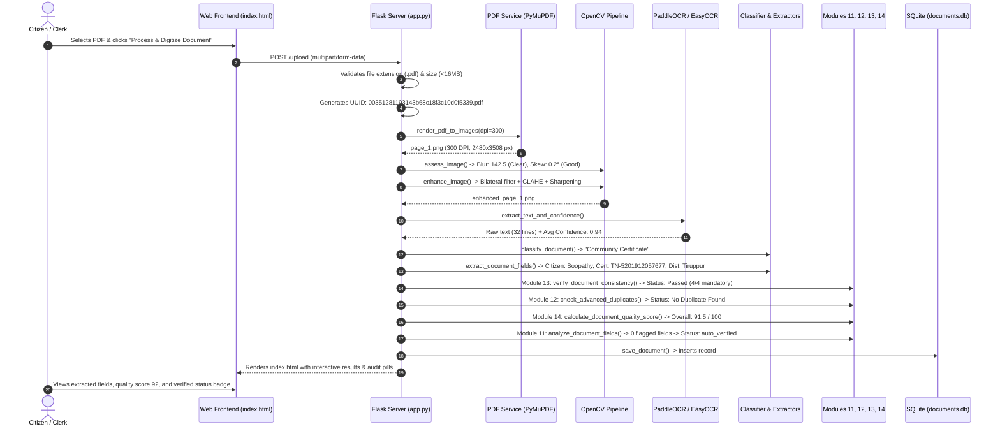
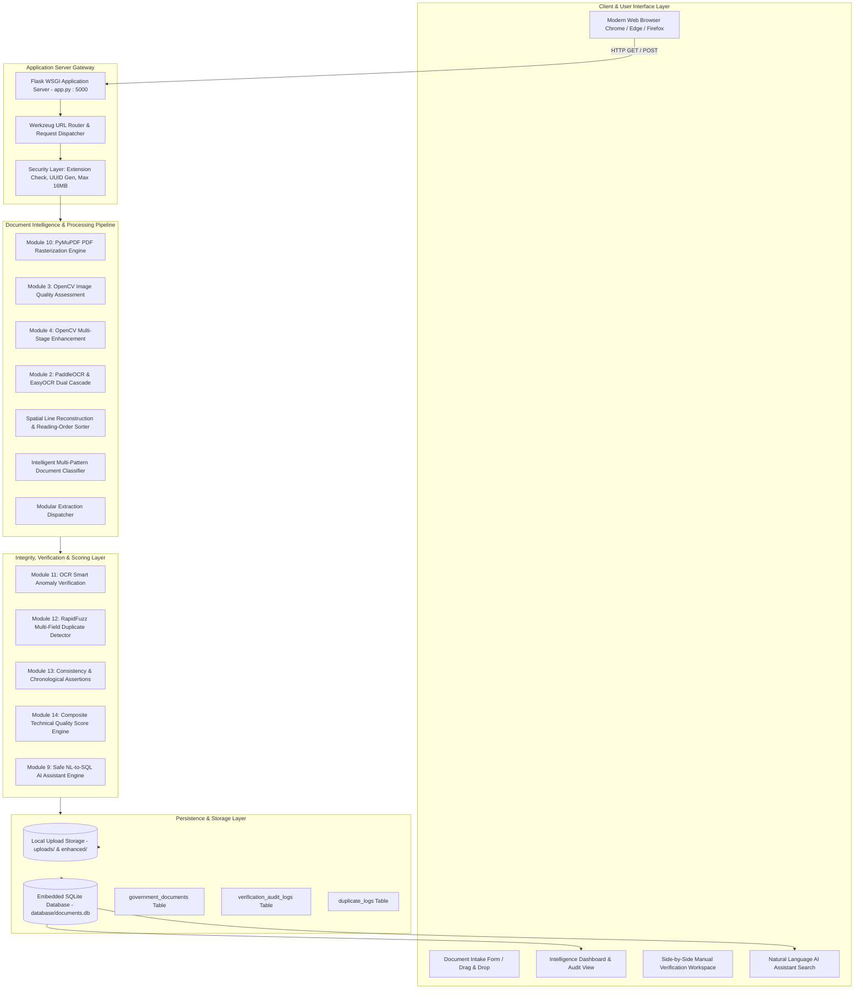
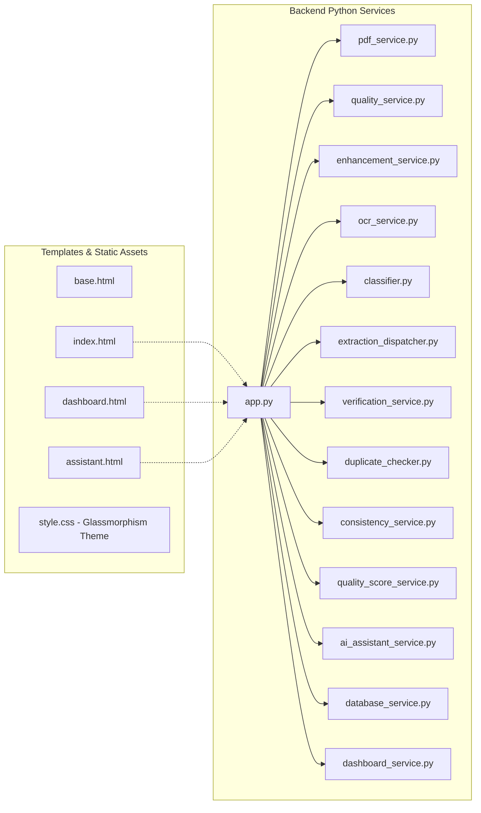
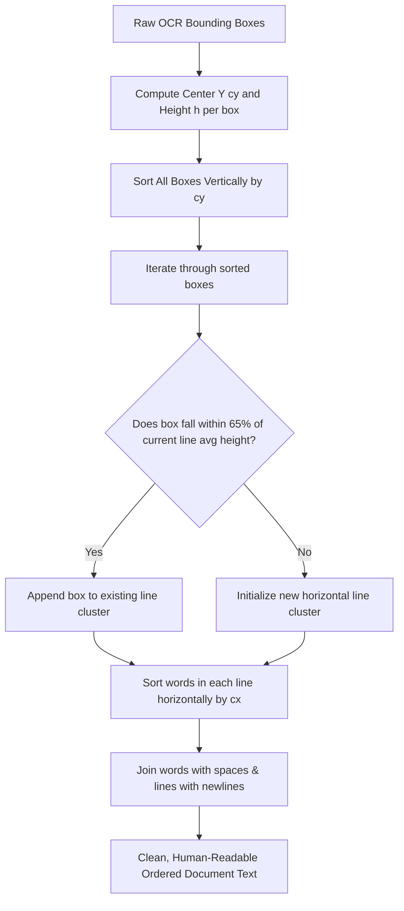
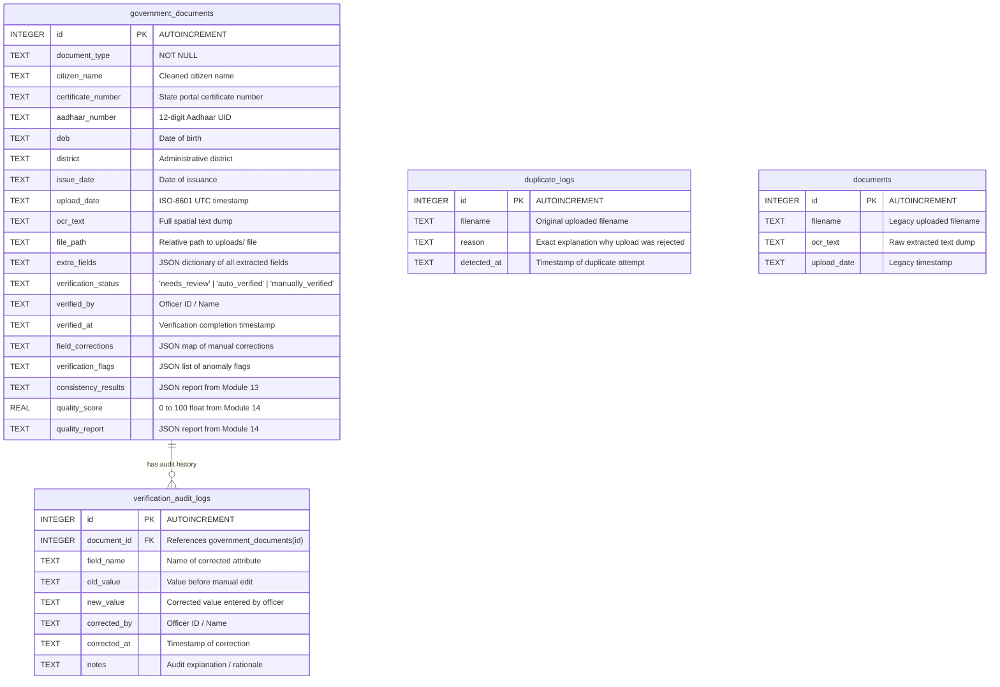
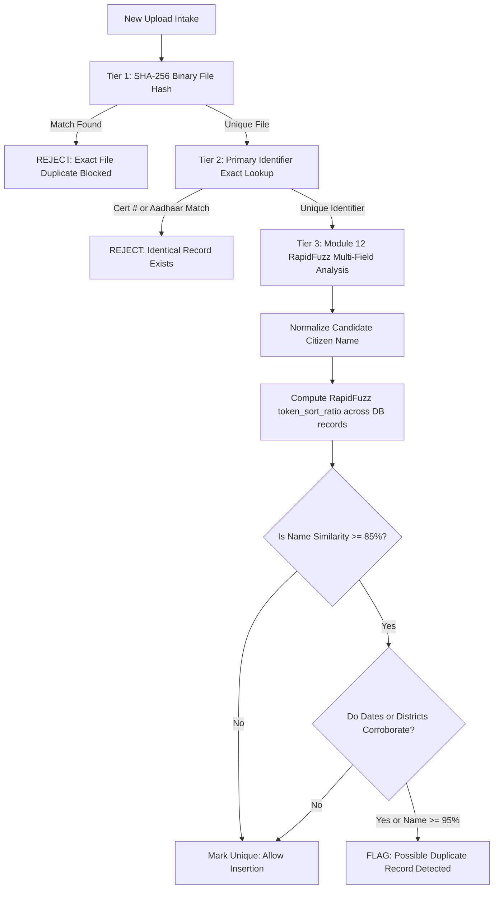
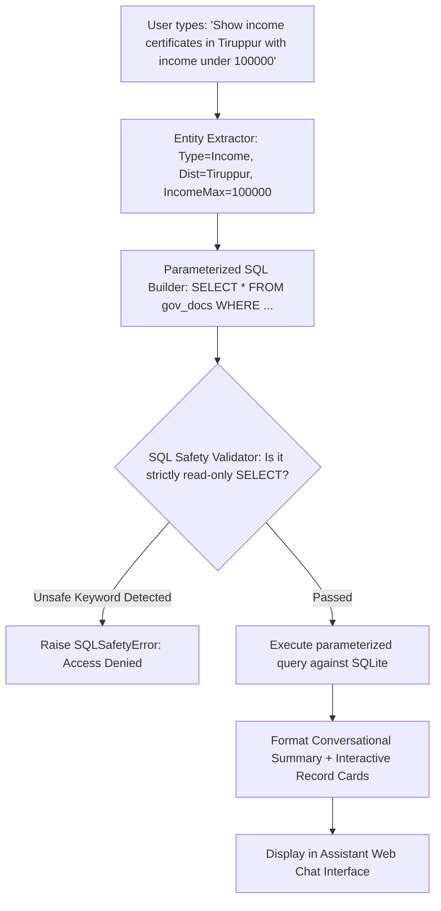

# Smart Document Digitization Platform
## AI-Powered Government Document Intelligence, Verification, and Validation System
### Complete Technical Architecture, Implementation Deep Dive, and Viva Master Guide

**Author**: Computer Science & Engineering Candidate  
**Project Repository**: `d:\Mini project 3\SmartDocumentDigitization`  
**Core Technologies**: Python 3.11, Flask 3.1.3, PaddleOCR 2.8.1, EasyOCR 1.7.2, OpenCV 4.10, PyMuPDF 1.28, RapidFuzz 3.14, SQLite3  
**Status**: Fully Implemented & Verified (42 Unit Tests Passing)  
**Date**: October 2026  

---

## TABLE OF CONTENTS

- [PART 1: COMPLETE PROJECT OVERVIEW](#part-1-complete-project-overview)
  - [1.1 The Real-World Problem the Project Addresses](#11-the-real-world-problem-the-project-addresses)
  - [1.2 Why This Problem Matters](#12-why-this-problem-matters)
  - [1.3 Existing Approaches and Their Limitations](#13-existing-approaches-and-their-limitations)
  - [1.4 The Proposed Solution](#14-the-proposed-solution-smart-document-digitization-platform)
  - [1.5 Main Objectives](#15-main-objectives-of-the-project)
  - [1.6 Scope of the Project](#16-scope-of-the-project)
  - [1.7 Intended Users](#17-intended-users)
  - [1.8 Real-World Use Cases](#18-real-world-use-cases)
  - [1.9 Technical Utility & Value Proposition](#19-what-makes-this-implementation-useful-the-technical-edge)
  - [1.10 Actual Innovation and Technical Contributions](#110-actual-innovation-and-technical-contributions)
  - [1.11 Limitations & Out-of-Scope Boundaries](#111-limitations-and-what-the-project-does-not-solve)
  - [1.12 Key Conceptual Distinctions](#112-key-conceptual-distinctions-critical-for-viva-examination)
  - [1.13 Complete Worked Example (Document Trace)](#113-complete-worked-example-following-a-document-through-the-system)
- [PART 2: COMPLETE TECHNOLOGY STACK](#part-2-complete-technology-stack)
  - [2.1 Complete Technology Inventory](#21-complete-technology-inventory)
  - [2.2 Deep Dive on Each Technology](#22-deep-dive-on-each-technology)
- [PART 3: COMPLETE ARCHITECTURE](#part-3-complete-architecture)
  - [3.1 High-Level Architecture Diagram](#31-high-level-architecture-diagram)
  - [3.2 Component-Level Architecture & Interaction](#32-component-level-architecture--interaction-diagram)
  - [3.3 Storage Architecture](#33-storage-architecture)
- [PART 4: COMPLETE END-TO-END PROJECT WORKFLOW](#part-4-complete-end-to-end-project-workflow)
  - [4.1 Step-by-Step Document Lifecycle Table](#41-step-by-step-document-lifecycle)
  - [4.2 Detailed Analysis of Each Step](#42-detailed-analysis-of-each-step)
- [PART 5: COMPLETE CODEBASE AND FILE-BY-FILE EXPLANATION](#part-5-complete-codebase-and-file-by-file-explanation)
  - [5.1 Complete Project Directory Tree](#51-complete-project-directory-tree)
  - [5.2 Exhaustive File-by-File Breakdown](#52-exhaustive-file-by-file-breakdown)
- [PART 6: FLASK BACKEND AND API EXPLANATION](#part-6-flask-backend-and-api-explanation)
  - [6.1 Application Architecture and Initialization](#61-application-architecture-and-initialization)
  - [6.2 Complete REST API Reference Table](#62-complete-rest-api-reference-table)
  - [6.3 HTTP Methods Explained](#63-http-methods-explained-what-this-project-actually-uses)
- [PART 7: OCR AND IMAGE PROCESSING — DEEP EXPLANATION](#part-7-ocr-and-image-processing--deep-explanation)
  - [7.1 OCR Fundamentals for Technical Viva](#71-ocr-fundamentals-for-technical-viva)
  - [7.2 PaddleOCR and EasyOCR Configuration](#72-paddleocr-and-easyocr-configuration-in-the-codebase)
  - [7.3 Spatial Reading-Order Line Reconstruction Algorithm](#73-spatial-reading-order-line-reconstruction-algorithm)
  - [7.4 OpenCV Preprocessing Pipeline Formulations](#74-opencv-preprocessing-pipeline-mathematical-formulations)
  - [7.5 Model Training vs. Inference Clarification](#75-model-training-vs-inference-clarification)
- [PART 8: DOCUMENT CLASSIFICATION AND FIELD EXTRACTION](#part-8-document-classification-and-field-extraction)
  - [8.1 Document Classification Architecture](#81-document-classification-architecture)
  - [8.2 Field Extraction Strategies](#82-field-extraction-strategies)
- [PART 9: DATABASE AND DATA MANAGEMENT](#part-9-database-and-data-management)
  - [9.1 Database Schema & Entity Relationship Diagram](#91-database-schema--entity-relationship-diagram)
  - [9.2 Complete Field-by-Field Data Dictionary](#92-complete-field-by-field-data-dictionary)
- [PART 10: DUPLICATE DETECTION (MODULE 12)](#part-10-duplicate-detection-module-12)
- [PART 11: VALIDATION, HUMAN REVIEW, AND QUALITY SCORING](#part-11-validation-human-review-and-quality-scoring)
  - [11.1 Module 11: Smart Verification & Human Review Workspace](#111-module-11-smart-verification--human-review-workspace)
  - [11.2 Module 13: Consistency Verification Service](#112-module-13-consistency-verification-service)
  - [11.3 Module 14: Composite Document Quality Score](#113-module-14-composite-document-quality-score)
- [PART 12: AI DOCUMENT ASSISTANT (MODULE 9)](#part-12-ai-document-assistant-module-9)
  - [12.1 Natural Language to Safe SQL Architecture](#121-natural-language-to-safe-sql-architecture)
- [PART 13: FRONTEND AND USER INTERFACE](#part-13-frontend-and-user-interface)
  - [13.1 Design System & Aesthetic Architecture](#131-design-system--aesthetic-architecture)
- [PART 14: SECURITY, PRIVACY, AND ERROR HANDLING](#part-14-security-privacy-and-error-handling)
- [PART 15: INSTALLATION AND EXECUTION ON WINDOWS](#part-15-installation-and-execution-on-windows)
  - [15.1 Prerequisites and System Requirements](#151-prerequisites-and-system-requirements)
  - [15.2 Step-by-Step Installation Guide](#152-step-by-step-installation-guide)
  - [15.3 Running the Application](#153-running-the-application)
  - [15.4 Common Windows Troubleshooting Scenarios](#154-common-windows-troubleshooting-scenarios)
- [PART 16: TESTING AND PERFORMANCE](#part-16-testing-and-performance)
  - [16.1 Automated Test Suite Overview](#161-automated-test-suite-overview)
  - [16.2 Test Case Specification Table](#162-test-case-specification-table)
- [PART 17: HARDWARE INTEGRATION (HONEST STATUS REPORT)](#part-17-hardware-integration-honest-status-report)
- [PART 18: WHY THIS TECHNOLOGY INSTEAD OF ALTERNATIVES?](#part-18-why-this-technology-instead-of-alternatives)
- [PART 19: LIMITATIONS, FAILURE SCENARIOS, AND FUTURE WORK](#part-19-limitations-failure-scenarios-and-future-work)
  - [19.1 Real Limitations in Current Codebase](#191-real-limitations-in-current-codebase)
  - [19.2 Prioritized Future Roadmap](#192-prioritized-future-roadmap)
- [PART 20: COMPLETE VIVA AND EXTERNAL EXAMINATION QUESTION BANK](#part-20-complete-viva-and-external-examination-question-bank)
- [PART 21: PRESENTATION AND EXPLANATION SCRIPTS](#part-21-presentation-and-explanation-scripts)
- [PART 22: GLOSSARY AND CONCEPT LEARNING GUIDE](#part-22-glossary-and-concept-learning-guide)
- [PART 23: MASTER REVISION SHEET](#part-23-master-revision-sheet)

---

# PART 1: COMPLETE PROJECT OVERVIEW

## 1.1 The Real-World Problem the Project Addresses

Across public administration, local revenue departments, educational institutions, and civic service centers in India (such as Tamil Nadu e-Sevai centers, Tahsildar offices, and university admissions desks), millions of citizen documents are processed annually. These documents include:
- **Income Certificates** (for welfare eligibility, fee waivers, and government scholarships)
- **Community / Caste Certificates** (for reservation policies, administrative allotments, and affirmative action)
- **Birth Certificates** (for age and citizenship verification)
- **Identity Cards** (Aadhaar cards, PAN cards, and Driving Licences)
- **Institutional Applications** (Student permission forms and bonafide attestations)

Despite state initiatives toward digital e-governance (such as Tamil Nadu's e-District portal and Digilocker), administrative offices face massive daily operational friction:
1. **Paper-to-Digital Ingestion Bottlenecks**: Citizens frequently present physical printed copies, laminated cards, mobile photo scans, or downloaded PDF prints. Data entry operators must manually re-type citizen names, 16-to-24 character certificate numbers, father/guardian details, taluks, and income amounts into departmental databases.
2. **Clerical Data Entry Errors**: Manual typing under high-volume workloads leads to spelling corruptions, transposed numbers in certificate codes, and mismatched dates, resulting in rejected welfare applications or delayed scholarship disbursements.
3. **Unindexed "Flat" Digital Storage**: When offices attempt digitization by simply scanning documents into folders as PDFs or JPEGs, these files remain "digital paper." They are flat binary images without searchability. An officer cannot run an SQL query such as *"List all Income Certificates issued in Tiruppur District during 2023 with annual income under Rs. 1,00,000"* because the contents are locked inside pixels.
4. **Duplicate Issuance and Fraud Risks**: Without automated deduplication across submitted documents, applicants may accidentally or intentionally submit duplicate claims across different welfare counters or submit slightly altered re-scans of identical certificates.
5. **Lack of Explainable Quality Control**: Clerks often accept low-resolution, blurry, or skewed scans that later fail audits because there is no automated intake gatekeeper assessing whether a scan has sufficient visual clarity and complete mandatory fields.

---

## 1.2 Why This Problem Matters

1. **Direct Impact on Citizen Welfare**: A typo in an annual income figure (e.g., typing `Rs. 7,80,000` instead of `Rs. 78,000` due to misreading faint dot-matrix printing) can disqualify an underprivileged student from a government higher-education grant.
2. **Administrative Efficiency**: Manual inspection of a single certificate takes an officer 3 to 7 minutes. Multiplying this across thousands of applicants during admission or subsidy cycles causes multi-week backlogs.
3. **Data Integrity for Policy Making**: District collectors and department heads cannot analyze aggregated economic or demographic trends if records are siloed in paper files or non-indexed file directories.
4. **Auditability and Traceability**: In government administration, any manual correction of an official field must be accountable. An audit log documenting who corrected a field, at what timestamp, and based on what scan evidence is vital for institutional trust.

---

## 1.3 Existing Approaches and Their Limitations

| Approach | Working Principle | Key Limitations |
| :--- | :--- | :--- |
| **1. Manual Clerical Data Entry** | Human operators view the paper/scan and type fields into web forms. | Slow (3–7 mins/doc); high human error rate (5–12% on long alphanumeric IDs); employee fatigue; no instant duplicate checking. |
| **2. Flat Image/PDF Archiving** | Scanners create PDF/TIFF files saved in folder trees on local drives. | Completely unindexed; zero structured extraction; cannot be searched by content; cannot perform automated validation. |
| **3. Basic Desktop OCR (e.g., Standalone Tesseract GUI)** | Converts image to a single raw `.txt` file using generic language models. | High error rate on bilingual certificates (Tamil + English); collapses when facing watermarks, skew, or stamps; outputs unstructured text dumps without extracting semantic fields. |
| **4. Proprietary Cloud OCR APIs (AWS Textract, Google Cloud Vision)** | Sends images over internet to cloud machine learning models for JSON extraction. | **Privacy & Sovereignty Concerns**: Indian PII (Aadhaar numbers, residential details, citizen income) sent to commercial cloud servers; **Recurring Cost**: Expensive per-page API pricing; **Internet Dependency**: Fails in rural taluk offices with intermittent network connectivity. |
| **5. Barcode / QR Code Scanners** | Reads 2D QR codes printed on modern certificates. | Inapplicable to older certificates, scanned photocopies where QR codes are distorted, or documents without 2D codes; fails if the QR data format is proprietary or encrypted. |

---

## 1.4 The Proposed Solution: Smart Document Digitization Platform

The **Smart Document Digitization Platform** is an on-premise, privacy-preserving, AI-powered document intelligence and automated validation system engineered using **Python, Flask, PaddleOCR, EasyOCR, OpenCV, PyMuPDF, RapidFuzz, and SQLite**.

The platform operates as a complete local intelligence pipeline:
1. **Multi-Format Document Intake**: Ingests camera photos, desktop scans (PNG, JPG, JPEG), and multi-page government PDF files up to 16 MB.
2. **Multi-Page PDF Rasterization**: Employs PyMuPDF (`fitz`) to render PDF pages into clean 300 DPI high-resolution image matrices while extracting any embedded text streams.
3. **Image Quality Assessment & Auto-Enhancement**: Uses OpenCV to compute blur (Laplacian variance), brightness distribution, and skew angle (probabilistic Hough transform), automatically applying super-resolution upscaling (Lanczos-4), bilateral edge-preserving filtering, CLAHE contrast enhancement, and unsharp masking.
4. **Dual-Engine OCR with Spatial Reading-Order Line Reconstruction**: Uses PaddleOCR as the primary deep-learning engine (DBNet text detector + SVTR/CRNN recognizer) with automatic fallback to EasyOCR (CRAFT + ResNet-BiLSTM-CTC). A custom bounding-box clustering algorithm sorts detected text blocks into human-readable horizontal lines.
5. **Intelligent Document Classification**: Applies resilient multi-pattern bilingual regex engines that identify document types (Income Certificate, Community Certificate, Birth Certificate, Aadhaar Card, Student Permission Form).
6. **Domain-Specific Structured Field Extraction**: Modular extraction dispatchers parse specific fields (Citizen Name, Certificate Number, Aadhaar UID, Date of Birth, District, Taluk, Annual Income, Community) with fuzzy dictionary fallbacks (e.g., resolving taluk names like `Avinashi` to `Tiruppur` District via an exhaustive 38-district Tamil Nadu mapping).
7. **Explainable Anomaly Verification (Module 11)**: Detects character corruptions, validates alphanumeric formatting standards, flags OCR uncertainties, and presents an interactive **Manual Verification Workspace** with side-by-side scan inspection and audit sign-off.
8. **Advanced Multi-Field Deduplication (Module 12)**: Performs SHA-256 binary file hash matching, exact certificate/Aadhaar identifier lookup, and multi-field fuzzy string comparison via **RapidFuzz** (`token_sort_ratio`) to intercept redundant submissions.
9. **Logical Consistency & Chronological Validation (Module 13)**: Executes cross-field consistency assertions (validating mandatory fields, Tamil Nadu district boundaries, and chronological logic such as verifying that an issue date occurs after date of birth).
10. **Composite Technical Quality Scoring (Module 14)**: Calculates an objective 0–100 quality score weighted across Image Clarity (30%), OCR Engine Confidence (30%), and Mandatory Field Completeness (40%).
11. **Natural Language AI Record Assistant (Module 9)**: Provides a conversational search interface that translates plain-English questions into strictly validated, read-only parameterized SQLite queries, guaranteeing 100% data grounding and zero hallucinations.

---

## 1.5 Main Objectives of the Project

1. **Automate Document Intake**: Eliminate manual data entry by extracting key-value pairs from complex Indian state certificates with >90% field accuracy.
2. **Ensure 100% Data Sovereignty**: Execute all preprocessing, deep-learning OCR, extraction, and search locally on the host machine without transmitting citizen records to third-party cloud APIs.
3. **Prevent Duplicate Records**: Detect both identical file re-uploads and multi-field semantic duplicates using fuzzy string metrics.
4. **Provide Explainable Human-in-the-Loop Oversight**: Present clerks with intuitive confidence indicators, anomaly warnings, and a certified manual verification interface.
5. **Enable Conversational Natural Language Search**: Allow non-technical officers to query the database in plain English without writing SQL.

---

## 1.6 Scope of the Project

### In-Scope
- **Supported Formats**: PNG, JPG, JPEG, and single/multi-page PDF documents.
- **Supported Document Types**:
  - Tamil Nadu Revenue Department Income Certificates (`TN-4202...`)
  - Tamil Nadu Community / Caste Certificates (`TN-5201...`, `TN-GCC...`)
  - Birth Certificates (Corporation/Municipality/Panchayat forms)
  - Indian Aadhaar Cards (UIDAI e-Aadhaar and card scans)
  - PAN Cards and Driving Licences (Module 13/14 rules supported)
  - Institutional forms (e.g., Kongu Engineering College Student Permission Forms)
- **Deployment**: Standalone workstation or local municipal intranet server running Windows/Linux.
- **Storage**: Local filesystem storage for uploads/enhanced images and local SQLite database (`database/documents.db`).

### Out-of-Scope (Important Viva Distinctions)
- **Direct State CA Integration**: The system does NOT connect to the Government of India Controller of Certifying Authorities (CCA) or e-District database backbones to verify cryptographic digital signatures or check revocation lists.
- **Physical Document Biometrics**: The system does not scan live physical fingerprints or iris biometrics.
- **Unconstrained Historical Cursive Manuscripts**: The system is engineered for modern printed and standard hybrid government certificates; it is not designed for ancient handwritten palm leaves or unconstrained cursive scripts.

---

## 1.7 Intended Users

1. **Revenue and Taluk Office Clerks**: Operators processing e-Sevai certificates who need rapid digitization and verification.
2. **College & University Admissions Officers**: Verifying incoming student community certificates, income proofs, and Aadhaar identities.
3. **Bank and Micro-Finance Officers**: Reviewing identity documents and income proofs for priority sector lending.
4. **Civic Center Supervisors**: Monitoring digitized document counts, reviewing duplicate attempt logs, and conducting manual audits.

---

## 1.8 Real-World Use Cases

- **Use Case 1: First-Generation Graduate Scholarship Verification**: An applicant submits an Income Certificate and Community Certificate. The system rasterizes the PDF, upscales faint revenue stamps, extracts the annual income (`Rs. 78,000`), community (`Kongu Vellalars (Backward Class)`), and citizen name (`Boopathy`). It verifies that the income is below the scholarship ceiling, flags zero anomalies, and records the entry.
- **Use Case 2: Intercepting Fraudulent Re-Submissions**: An applicant changes the visual layout of a previously submitted certificate and attempts re-upload. The SHA-256 check fails, but the **Module 12 Advanced Duplicate Detector** matches the normalized certificate number `TN-5201912057677` with 100% confidence, blocking the duplicate and recording a security audit log.
- **Use Case 3: Natural Language Administrative Auditing**: A municipal supervisor opens the **AI Document Assistant** and types: *"How many community certificates were digitized from Tiruppur district?"* The assistant identifies the intent as an aggregation count, extracts the entity `Tiruppur` and type `Community Certificate`, generates `SELECT COUNT(*) FROM government_documents WHERE document_type = ? AND district = ?`, executes the query securely, and answers: *"There is 1 Community Certificate from Tiruppur on record."*

---

## 1.9 What Makes This Implementation Useful (The Technical Edge)

1. **Resilience to Real-World Scan Degeneracies**: Most textbook OCR projects fail when an image is slightly dark, tilted, or low-resolution. This platform incorporates a 7-stage OpenCV pipeline (Lanczos-4 scaling, bilateral edge filtering, CLAHE contrast equalization, unsharp masking, and Hough deskewing) that transforms illegible scans into high-contrast OCR inputs.
2. **Bilingual Vocabulary & Spatial Ordering**: Government certificates in Tamil Nadu interweave English and Tamil text (`வருமானச் சான்றிதழ் / Income Certificate`). The dual-engine architecture combined with spatial box sorting (`sort_boxes_into_lines`) preserves the natural left-to-right, top-to-bottom reading sequence.
3. **Zero-Hallucination Safe AI**: Unlike generative AI wrappers that might hallucinate non-existent records, the AI Assistant translates queries into deterministic SQL queries validated against a strict read-only keyword whitelist.

---

## 1.10 Actual Innovation and Technical Contributions

1. **Dual-Engine Dynamic Cascade**: Seamless integration of **PaddleOCR** (utilizing Differentiable Binarization DBNet detector and SVTR recognizer) with **EasyOCR** fallback, optimized specifically for Windows CPU environments without OpenMP thread deadlocks.
2. **Context-Aware OCR Anomaly Detection**: Implementation of regex-guided heuristics that detect typical OCR substitutions (such as confusing digit `0` and letter `O`, reading `Tn-` instead of `TN-`, or finding misplaced non-printable characters) and present the clerk with the exact surrounding context snippet from raw OCR.
3. **Taluk-to-District Semantic Inference**: An embedded geographic lookup dictionary that automatically resolves the correct administrative district even when the certificate only explicitly mentions the sub-district taluk.
4. **Hybrid Duplicate Detection Engine**: Combining exact cryptographic hashing (SHA-256), normalized primary identifier matching, and multi-field fuzzy Levenshtein ratio matching via RapidFuzz.

---

## 1.11 Limitations and What the Project Does Not Solve

1. **No External Cryptographic Trust Chain Verification**: While the system reads and parses digital signature annotations (`Digitally signed by...`), it does not validate X.509 PKI certificates against state HSM root certificates.
2. **Camera Specular Glare & Severe Folds**: Extremely high specular reflections on laminated ID cards can erase text pixels permanently, preventing optical recovery.
3. **Hardware Execution Status**: The ESP32-CAM module represents a proposed edge-capture architecture; in the current repository, all processing occurs via software uploads.

---

## 1.12 Key Conceptual Distinctions (Critical for Viva Examination)

Examiners frequently test students on the boundary lines between adjacent technical terms. You must master these exact distinctions:

```
+----------------------------------------------------------------------------------------------------+
|                                    DOCUMENT PROCESSING TAXONOMY                                   |
+------------------------------------+---------------------------------------------------------------+
| Concept                            | Exact Definition in This Project                              |
+------------------------------------+---------------------------------------------------------------+
| 1. Document Digitization           | The complete high-level lifecycle of converting a physical/    |
|                                    | digital file into structured, queryable database records.    |
+------------------------------------+---------------------------------------------------------------+
| 2. Optical Character Recognition   | The mechanical or electronic conversion of images of typed,   |
|    (OCR)                           | handwritten, or printed text into machine-encoded strings.    |
+------------------------------------+---------------------------------------------------------------+
| 3. Information Extraction (IE)     | The semantic parsing of raw unstructured OCR text into typed   |
|                                    | key-value pairs (e.g., mapping 'Boopathy' -> 'Citizen Name').  |
+------------------------------------+---------------------------------------------------------------+
| 4. Document Validation             | Checking extracted data against syntax, format, completeness, |
|                                    | and domain rules (e.g., verifying 12-digit Aadhaar syntax).    |
+------------------------------------+---------------------------------------------------------------+
| 5. Duplicate Detection             | Identifying whether a file or citizen record already exists    |
|                                    | in the system using hash comparison or fuzzy matching.        |
+------------------------------------+---------------------------------------------------------------+
| 6. Authenticity Verification       | Confirming that a document was legally issued by an authorized |
|                                    | authority and has not been forged (requires issuing agency).   |
+------------------------------------+---------------------------------------------------------------+
```

> **Viva Golden Rule**: *"Our project performs **Document Digitization, OCR, Information Extraction, Validation, and Duplicate Detection**. Our project assesses **Technical Quality and Completeness**, but it does NOT claim to prove legal **Authenticity Verification**, because legal authenticity requires querying the government's private PKI root server or official database."*

---

## 1.13 Complete Worked Example: Following a Document Through the System

Let us follow a real document through the entire implemented architecture from start to finish:

- **Input File**: `tamilnadu_community_cert.pdf` (Uploaded via web browser at `http://127.0.0.1:5000/`)
- **File Metadata**: Size 184 KB, single-page digitally signed e-District certificate.




---

# PART 2: COMPLETE TECHNOLOGY STACK

## 2.1 Complete Technology Inventory

Every technology listed below was identified directly from the active codebase (`backend/app.py`, `backend/services/`, `backend/requirements.txt`, and virtual environment `pip list`).

```
+-------------------------------------------------------------------------------------------------------------------------+
|                                              TECHNOLOGY STACK SUMMARY TABLE                                             |
+---------------------+-------------------+--------------------------------------+---------------------+------------------+
| Technology / Tool   | Exact Version     | Purpose in Project                   | Usage Location      | Implementation   |
|                     |                   |                                      |                     | Status           |
+---------------------+-------------------+--------------------------------------+---------------------+------------------+
| Python              | 3.11.x            | Core programming runtime             | Entire backend      | Currently Active |
| Flask               | 3.1.3             | Web application server & REST APIs   | backend/app.py      | Currently Active |
| Werkzeug            | 3.1.8             | HTTP routing & secure filename sanit | backend/app.py      | Currently Active |
| PaddleOCR           | 2.8.1             | Primary deep learning OCR engine     | ocr_service.py      | Currently Active |
| PaddlePaddle        | 2.6.2             | Deep learning runtime for PaddleOCR  | ocr_service.py      | Currently Active |
| EasyOCR             | 1.7.2             | Secondary fallback OCR engine        | ocr_service.py      | Currently Active |
| PyTorch (torch)     | 2.13.0            | Neural network backend for EasyOCR   | ocr_service.py      | Currently Active |
| OpenCV (cv2)        | 4.10.0.84         | Image quality assessment & enhance   | quality/enhancement | Currently Active |
| NumPy               | 1.26.4            | High-performance matrix computations | quality/enhancement | Currently Active |
| PyMuPDF (fitz)      | 1.28.2            | Multi-page PDF rasterization & text  | pdf_service.py      | Currently Active |
| RapidFuzz           | 3.14.6            | Fuzzy string matching for duplicates | duplicate_checker.py| Currently Active |
| Regular Expressions | Standard Library  | Classification & field extraction    | services/extractors | Currently Active |
| SQLite3             | Standard Library  | Embedded relational database         | database_service.py | Currently Active |
| Jinja2              | 3.1.6             | Server-side HTML template rendering  | backend/templates   | Currently Active |
| HTML5 & Vanilla CSS | Custom Standard   | User interface & glassmorphism theme | backend/static/css  | Currently Active |
| Vanilla JavaScript  | ES6+ Standards    | Dynamic DOM & Fetch API async calls  | dashboard.html etc  | Currently Active |
| Bootstrap & Icons   | 5.3 & 1.11 (CDN)  | Grid responsive layout & symbols     | base.html           | Currently Active |
| python-docx         | 1.2.0             | Automated technical document builder | doc_builder         | Currently Active |
| ESP32-CAM           | N/A               | Proposed hardware edge capture unit  | Conceptual / Docs   | Planned (Future) |
| Cloud LLMs (OpenAI) | None              | None (Intentionally avoided for PII) | None                | Not Used         |
+---------------------+-------------------+--------------------------------------+---------------------+------------------+
```

---

## 2.2 Deep Dive on Each Technology

### 1. Python (v3.11)
- **What it is**: High-level, garbage-collected, dynamically-typed programming language.
- **Why used**: De-facto industry standard for artificial intelligence, computer vision (OpenCV), and document processing with robust C-extension wrappers.
- **Where used**: Powers 100% of the backend logic across all 20+ Python source files in `backend/`.
- **Internal working**: Executes via CPython bytecode interpreter. Python 3.11 introduces the Faster CPython initiative (specialized adaptive bytecode, inline frame caching), providing 25–40% faster execution than Python 3.9 for dictionary lookups and regex execution.
- **Viva Q&A**:
  - *Q: Why Python 3.11 over Python 3.8?*
  - *A: Python 3.11 provides significant performance improvements in dictionary parsing, enhanced exception tracebacks with exact expression locations, and compatibility with modern PaddlePaddle and PyMuPDF wheels.*

### 2. Flask (v3.1.3)
- **What it is**: Lightweight Web Server Gateway Interface (WSGI) web application framework.
- **Why used**: Minimalist design with zero boilerplate. It does not force an ORM or rigid directory structure like Django, making it ideal for microservices and document pipelines.
- **Where used**: `backend/app.py` defines application factories (`create_app`), routes (`/`, `/upload`, `/dashboard`, `/assistant`, `/api/...`), and request lifecycles.
- **Internal working**: Utilizes Werkzeug for routing and request/response abstraction and Jinja2 for server-side HTML rendering. Request dispatching maps HTTP endpoints to Python callables using decorators (`@app.route`).
- **Viva Q&A**:
  - *Q: Why not FastAPI?*
  - *A: While FastAPI offers native async, our workload is CPU-bound (OCR rasterization and OpenCV matrix filtering), which does not benefit from an async event loop unless multi-process worker pools are deployed. Flask provides simpler server-rendered HTML template integration alongside REST APIs.*

### 3. PaddleOCR (v2.8.1) & PaddlePaddle (v2.6.2)
- **What it is**: State-of-the-art open-source OCR toolchain developed by Baidu based on the PaddlePaddle deep-learning framework.
- **Why used**: Outperforms Tesseract and EasyOCR on complex documents containing small fonts, high noise, and mixed tabular data.
- **Where used**: `backend/ocr_service.py` (`get_paddle_ocr()`, `extract_text_and_confidence()`).
- **Internal working**: Operates as a two-stage deep neural network pipeline:
  1. **Text Detection**: Employs **DBNet** (Real-time Scene Text Detection with Differentiable Binarization) using a lightweight MobileNetV3/ResNet backbone to segment arbitrary-shaped text bounding boxes.
  2. **Direction Classification**: Detects text orientation (0°, 90°, 180°, 270°) and rotates text patches.
  3. **Text Recognition**: Uses **SVTR** (Single Visual Model for Scene Text Recognition) or **CRNN** (Convolutional Recurrent Neural Network with Connectionist Temporal Classification loss) to decode pixel features into Unicode strings.
- **Viva Q&A**:
  - *Q: How does DBNet differ from traditional segmentation?*
  - *A: Traditional segmentation applies standard step-function binarization which is non-differentiable. DBNet incorporates a differentiable binarization formulation into the neural network training loss, allowing the network to adaptively set binarization thresholds per pixel.*

### 4. EasyOCR (v1.7.2) & PyTorch (v2.13.0)
- **What it is**: Deep-learning OCR library built on PyTorch supporting 80+ languages.
- **Why used**: Functions as a resilient offline secondary fallback if PaddleOCR encounters environment or DLL issues, and provides bilingual Tamil (`ta`) recognition support.
- **Where used**: `backend/ocr_service.py` (`get_reader()`).
- **Internal working**: Uses **CRAFT** (Character Region Awareness for Text Detection) to predict character centers and affinities, followed by a **ResNet** feature extractor, **BiLSTM** sequence encoder, and **CTC** (Connectionist Temporal Classification) decoder.
- **Viva Q&A**:
  - *Q: Why use dual OCR engines (PaddleOCR + EasyOCR)?*
  - *A: Redundancy and specialized accuracy. PaddleOCR provides superior line extraction and speed on printed alphanumeric English certificates, while EasyOCR provides localized Tamil character recognition.*

### 5. OpenCV (cv2 v4.10.0) & NumPy (v1.26.4)
- **What it is**: High-performance Open Source Computer Vision library written in C/C++ with Python bindings.
- **Why used**: Essential for pre-OCR image quality measurement and visual artifact suppression.
- **Where used**: `backend/quality_service.py` and `backend/enhancement_service.py`.
- **Internal working**: Represents images as multi-dimensional NumPy arrays (`ndarray`) of shape `(Height, Width, Channels)` with `uint8` data types.
  - **Blur Detection**: Calculates the variance of the 2D Laplacian operator ($
abla^2 f = rac{\partial^2 f}{\partial x^2} + rac{\partial^2 f}{\partial y^2}$). High edge variance indicates a sharp image; low variance indicates blur.
  - **Super-Resolution Upscaling**: Interpolates small scans using Lanczos-4 sinc windowing over an 8x8 pixel neighborhood.
  - **Contrast Enhancement**: Applies Contrast Limited Adaptive Histogram Equalization (CLAHE) over localized 8x8 contextual tiles, preventing noise amplification.
  - **Skew Estimation**: Computes probabilistic Hough line transforms (`HoughLinesP`) on Canny edge maps, calculating the median angle of dominant text baselines.

### 6. PyMuPDF (fitz v1.28.2)
- **What it is**: Extremely fast Python binding for MuPDF, a lightweight PDF, XPS, and eBook rendering engine.
- **Why used**: Native multi-page PDF processing. Unlike `pdf2image` (which requires external `poppler` binaries that are notoriously difficult to configure on Windows), PyMuPDF is completely self-contained.
- **Where used**: `backend/pdf_service.py` (`render_pdf_to_images()`).
- **Internal working**: Directly parses the PDF DOM cross-reference table (`xref`), extracts font streams and embedded digital text, and renders vector page viewports into rasterized bitmaps at user-specified DPI (300 DPI) using anti-aliased font rasterizers.

### 7. RapidFuzz (v3.14.6)
- **What it is**: High-performance C++ implementation of fuzzy string matching algorithms with Python bindings (faster drop-in replacement for FuzzyWuzzy).
- **Why used**: Module 12 Advanced Duplicate Detection requires comparing citizen names that may have minor OCR typos or word reordering (e.g., `Gopal N` vs `N. Gopal`).
- **Where used**: `backend/services/duplicate_checker.py` (`check_advanced_duplicates()`).
- **Internal working**: Computes **Levenshtein distance** and **Token Sort Ratio**. Token Sort Ratio tokenizes strings, converts them to lowercase, strips punctuation, sorts tokens alphabetically, and then computes the normalized similarity score. This ensures that name order permutations achieve a 100% similarity score.

### 8. SQLite3
- **What it is**: Self-contained, serverless, zero-configuration, transactional relational database engine.
- **Why used**: Perfect for local on-premise government office deployments. Requires no database administration server, runs entirely within the host filesystem (`database/documents.db`), and supports atomic ACID transactions.
- **Where used**: `backend/services/database_service.py`, `backend/services/dashboard_service.py`, `backend/services/verification_service.py`.
- **Internal working**: Utilizes B-Tree file pages for indexing and rollback journals for crash recovery. All connections are wrapped in context managers (`get_connection()`) enforcing `sqlite3.Row` dictionaries and parameterized queries (`?`).

---

# PART 3: COMPLETE ARCHITECTURE

## 3.1 High-Level Architecture Diagram



---

## 3.2 Component-Level Architecture & Interaction Diagram



---

## 3.3 Storage Architecture

```
d:\Mini project 3\SmartDocumentDigitization│
├── database│   └── documents.db          <-- Single transactional SQLite database file
│                                 Contains: government_documents, duplicate_logs,
│                                 verification_audit_logs, documents tables.
│
└── uploads\                  <-- Primary physical storage directory
    ├── [uuid].pdf            <-- Master uploaded original files (UUID-named)
    ├── [uuid].png            <-- Master uploaded original image files
    │
    ├── enhanced\             <-- Derived preprocessed image directory
    │   └── enhanced_[uuid].png <-- Bilateral-filtered, CLAHE-enhanced images
    │
    └── pdf_pages\            <-- Rasterized PDF page directory
        └── [uuid]            ├── [uuid]_page_1.png (300 DPI high-res page render)
            └── [uuid]_page_2.png
```

- **UUID Decoupling**: Uploaded files are immediately renamed to `uuid4().hex + extension` (e.g., `00351281193143b68c18f3c10d0f5339.pdf`). This completely mitigates directory traversal attacks, prevents filename collisions, and avoids issues with non-ASCII or spaces in original file names.
- **Relational Integrity**: The relative file path (`uploads/00351281193143b68c18f3c10d0f5339.pdf`) is persisted in `government_documents.file_path`, allowing web views to serve the original document via `/uploads/<filename>`.


---

# PART 4: COMPLETE END-TO-END PROJECT WORKFLOW

## 4.1 Step-by-Step Document Lifecycle

Below is the verified, exact order of execution that occurs from the moment a user interacts with the application to the moment data is indexed and queried.

```
+------------------------------------------------------------------------------------------------------------------------+
|                                              22-STEP DOCUMENT LIFECYCLE                                                |
+------+-------------------------------+-----------------------------------+---------------------------------------------+
| Step | Action                        | Executing File & Function         | Primary Output / Data State                 |
+------+-------------------------------+-----------------------------------+---------------------------------------------+
| 1    | User opens Web Portal         | app.py -> home()                  | Renders index.html upload form              |
| 2    | User uploads file             | Browser -> POST /upload           | multipart/form-data payload                 |
| 3    | Extension check               | app.py -> allowed_file()          | Validates .png, .jpg, .jpeg, .pdf           |
| 4    | Secure UUID Renaming          | app.py -> upload_document()       | Writes uploads/<uuid>.<ext>                 |
| 5    | PDF Ingestion & Rasterize     | pdf_service.py -> render_pdf...() | Renders uploads/pdf_pages/<uuid>_page_1.png |
| 6    | Image Quality Assessment      | quality_service.py -> assess_...()| Blur, brightness, skew scores               |
| 7    | Multi-Stage Enhancement       | enhancement_service.py -> enhance | Generates uploads/enhanced/enhanced_<uuid>  |
| 8    | Dual-Engine OCR Extraction    | ocr_service.py -> extract_text... | PaddleOCR / EasyOCR bounding box items      |
| 9    | Spatial Line Reconstruction   | ocr_service.py -> sort_boxes...() | Human-readable ordered multiline text string|
| 10   | Document Classification       | classifier.py -> classify_...()   | Identified document_type string             |
| 11   | Extraction Dispatching        | extraction_dispatcher.py -> ext.. | Dynamically imports services.extractors.<t> |
| 12   | Structured Field Parsing      | extractors/<type>.py              | Dictionary of extracted key-value pairs     |
| 13   | Geographic Auto-Resolution    | extractors/common.py              | Resolves district from taluk if missing     |
| 14   | Document Consistency Checks   | consistency_service.py (M13)      | Completeness & chronological assertion rep  |
| 15   | Advanced Duplicate Detection  | duplicate_checker.py (M12)        | Exact ID & RapidFuzz fuzzy match report     |
| 16   | Technical Quality Scoring     | quality_score_service.py (M14)    | 0 to 100 objective composite score          |
| 17   | Smart Anomaly Verification    | verification_service.py (M11)     | Anomaly flags & initial verification status |
| 18   | Binary & Exact Dup Check      | duplicate_checker.py              | SHA-256 hash & stored identifier check      |
| 19   | Database Persistence          | database_service.py -> save_...() | INSERT INTO government_documents (ID gen)   |
| 20   | Duplicate Audit Logging       | dashboard_service.py -> log_...() | INSERT INTO duplicate_logs (if blocked)     |
| 21   | Interactive UI Presentation   | app.py -> render_template()       | Displays structured cards & audit status    |
| 22   | NL AI Assistant Querying      | ai_assistant_service.py (M9)      | Parameterized SQL execution & response card |
+------+-------------------------------+-----------------------------------+---------------------------------------------+
```

---

## 4.2 Detailed Analysis of Each Step

### Step 1: User Opens Application
- **File**: `backend/app.py` -> `home()`
- **Input**: HTTP GET request to `http://127.0.0.1:5000/`.
- **Processing**: Flask executes `render_template("index.html")`. Jinja2 injects base layout, navigation links, and drag-and-drop file upload container.
- **Output**: 200 OK HTML page.

### Step 2 to 4: File Transmission, Validation & Secure Storage
- **File**: `backend/app.py` -> `upload_document()`
- **Input**: Form field `document` via `multipart/form-data`.
- **Processing**:
  - Validates that `request.files.get("document")` is non-empty.
  - Calls `allowed_file(filename)` checking extension against `{"png", "jpg", "jpeg", "pdf"}`.
  - Generates secure random UUIDv4 filename: `saved_name = f"{uuid4().hex}.{extension}"`.
  - Saves file to disk at `app.config["UPLOAD_FOLDER"] / saved_name`.
- **Failure Mode**: If file is missing or extension is unauthorized, calls `flash()` with user-friendly error and redirects back to `/`.

### Step 5: PDF Rasterization (Module 10)
- **File**: `backend/pdf_service.py` -> `render_pdf_to_images(pdf_path, output_dir, dpi=300)`
- **Input**: Path to saved `.pdf` file.
- **Processing**: Opens PDF via `pymupdf.open()`. Renders page 0 using matrix zoom equivalent to 300 DPI (`zoom = 300 / 72 = 4.166`). Saves high-resolution PNG image at `uploads/pdf_pages/<uuid>/<uuid>_page_1.png`. Extracts embedded text streams.
- **Why Necessary**: Deep-learning OCR models (PaddleOCR / EasyOCR) accept pixel matrices, not vector PDF streams. Rasterizing at 300 DPI ensures crisp character strokes.

### Step 6 & 7: OpenCV Quality Assessment and Enhancement (Modules 3 & 4)
- **Files**: `quality_service.py` and `enhancement_service.py`
- **Processing**:
  1. Computes blur via variance of Laplacian ($\sigma^2_{	ext{Laplacian}}$). If $< 80.0$, marked as `Blurry`.
  2. Computes mean pixel intensity. If $< 70.0$, marked `Too dark`; if $> 190.0$, `Too bright`.
  3. Computes skew angle via `HoughLinesP`.
  4. Upscales low-resolution scans ($<1200	ext{px}$) via Lanczos-4 sinc interpolation.
  5. Smooths paper grain with edge-preserving bilateral filter (`cv2.bilateralFilter(d=5, sigmaColor=25, sigmaSpace=25)`).
  6. Equalizes local contrast via CLAHE (`clipLimit=2.2, tileGridSize=(8, 8)`).
  7. Sharpens letter edges via unsharp mask weighting: $	ext{Sharpened} = 1.4 	imes 	ext{Image} - 0.4 	imes 	ext{Gaussian}(	ext{Image})$.

### Step 8 & 9: Dual-Engine OCR & Spatial Line Sorting (Module 2)
- **File**: `backend/ocr_service.py` -> `extract_text_and_confidence()`
- **Processing**:
  - Passes enhanced image to `get_paddle_ocr().ocr(path, cls=True)`.
  - Filters out bounding boxes with confidence below 0.12.
  - If PaddleOCR returns no items, falls back to `easyocr.Reader.readtext()`.
  - Passes raw bounding boxes to `sort_boxes_into_lines()`:
    - Calculates center vertical coordinate $c_y = rac{y_1 + y_2}{2}$ and height $h$.
    - Groups boxes into the same line if vertical distance is within $0.65 	imes 	ext{average line height}$.
    - Sorts words within each horizontal line from left to right ($c_x$).
- **Output**: Clean multiline text string and mathematical average confidence score.

### Step 10 & 11: Document Classification & Modular Dispatch
- **Files**: `services/classifier.py` and `services/extraction_dispatcher.py`
- **Processing**:
  - Evaluates OCR text against ordered bilingual regex patterns in `CLASSIFICATION_PATTERNS`.
  - Matches keywords such as `வருமானச் சான்றிதழ்` or `TN-4202\d+` $
ightarrow$ `Income Certificate`.
  - Converts display type to module name: `Income Certificate` $
ightarrow$ `income_certificate`.
  - Uses `importlib.import_module("services.extractors.income_certificate")` to call `extract_fields()`.

### Step 12 & 13: Structured Field Extraction & Geographic Mapping
- **Files**: `services/extractors/*.py` and `services/extractors/common.py`
- **Processing**:
  - Extracts Citizen Name, Father/Husband Name, Certificate Number, Annual Income, Community, Dates, and District.
  - If District is absent but Taluk is extracted (e.g., `Avinashi`), looks up `TALUK_TO_DISTRICT_MAP["avinashi"]` $
ightarrow$ resolves `Tiruppur`.

### Step 14 to 17: Validation, Deduplication, Quality Scoring, and Verification
- **Module 13 (Consistency)**: Verifies that mandatory fields are present and formats are valid (e.g., checking that certificate numbers begin with `TN-`).
- **Module 12 (Duplicate Detection)**: Evaluates RapidFuzz Token Sort Ratio on citizen name and cross-references dates/districts against existing records.
- **Module 14 (Quality Score)**: Calculates weighted formula:
  $$	ext{Score} = 0.30 	imes 	ext{ImageScore} + 0.30 	imes 	ext{OCRConfidence} + 0.40 	imes 	ext{CompletenessScore}$$
- **Module 11 (Verification)**: Checks for anomalous OCR characters (e.g., `?`, `*`, `~`). If zero anomalies and consistency passed, sets status to `auto_verified`; otherwise `needs_review`.

### Step 18 to 20: Persistence & Deduplication Enforcement
- **Files**: `backend/services/database_service.py` and `dashboard_service.py`
- **Processing**:
  - Executes SHA-256 binary hash matching against all files in `uploads/`.
  - Executes exact certificate number and Aadhaar matching.
  - If a duplicate is detected: Aborts insertion, logs rejection in `duplicate_logs` table, and flashes alert to user.
  - If unique: Executes `INSERT INTO government_documents` with all fields, quality scores, and verification status.

### Step 21 & 22: Dashboard Presentation & AI Search
- Records appear immediately in the **Intelligence Dashboard** with verified shield badges, district tags, and quality indicators.
- Non-technical officers can open the **AI Document Assistant** to query the new record conversationally.

---

# PART 5: COMPLETE CODEBASE AND FILE-BY-FILE EXPLANATION

## 5.1 Complete Project Directory Tree

```
d:\Mini project 3\SmartDocumentDigitization│
├── requirements.txt                   <-- Python package dependencies
├── .gitignore                         <-- Git tracking exclusions
├── Smart_Document_Digitization_Complete_Technical_Guide.md   <-- Master Markdown Guide
├── Smart_Document_Digitization_Complete_Technical_Guide.docx <-- Master Word Guide
│
├── backend\                           <-- Core Application Source Tree
│   ├── app.py                         <-- Flask application factory, routes & pipeline controller
│   ├── database.py                    <-- Legacy database helper functions
│   ├── documents.db                   <-- Active SQLite database file
│   ├── enhancement_service.py         <-- OpenCV image enhancement (Lanczos-4, CLAHE, Bilateral)
│   ├── ocr_service.py                 <-- Dual PaddleOCR & EasyOCR cascade & box line sorter
│   ├── pdf_service.py                 <-- PyMuPDF multi-page rasterization & text extraction
│   ├── quality_service.py             <-- OpenCV blur (Laplacian), brightness, and Hough skew
│   ├── seed_demo_data.py              <-- Script to populate realistic test records
│   │
│   ├── scripts│   │   └── reset_data.py              <-- Database and upload cleaning utility
│   │
│   ├── services\                      <-- Core Business Logic & Intelligence Modules
│   │   ├── __init__.py                <-- Service package initializer
│   │   ├── ai_assistant_service.py    <-- Module 9: Natural Language to Safe SQL Assistant
│   │   ├── classifier.py              <-- Bilingual regex document type classifier
│   │   ├── consistency_service.py     <-- Module 13: Consistency & chronological assertions
│   │   ├── dashboard_service.py       <-- Module 8: Dashboard aggregations & audit logs
│   │   ├── database_service.py        <-- Central SQLite schema, migrations & persistence
│   │   ├── duplicate_checker.py       <-- Module 12: SHA-256, ID, & RapidFuzz duplicate engine
│   │   ├── extraction_dispatcher.py   <-- Dynamic module loading based on document type
│   │   ├── quality_score_service.py   <-- Module 14: Objective technical quality scoring
│   │   ├── verification_service.py    <-- Module 11: Explainable field verification & manual review
│   │   │
│   │   └── extractors\                <-- Document-Specific Regex Extractors
│   │       ├── __init__.py            <-- Extractor package initializer
│   │       ├── aadhaar.py             <-- Aadhaar UIDAI card extraction & cleaning
│   │       ├── aadhaar_card.py        <-- Aadhaar extractor alias
│   │       ├── birth_certificate.py   <-- Birth certificate extraction (child, parents, DOB)
│   │       ├── common.py              <-- Reusable regexes, Taluk-to-District map & name clean
│   │       ├── community_certificate.py <-- Community / Caste certificate parser
│   │       ├── driving_licence.py     <-- Indian driving licence parser
│   │       ├── generic.py             <-- Fallback regex extractor for unclassified documents
│   │       ├── income_certificate.py  <-- Income certificate parser (annual income & applicant)
│   │       └── pan_card.py            <-- Income Tax PAN card parser
│   │
│   ├── static\                        <-- Client-Side Web Assets
│   │   └── css│   │       └── style.css              <-- Master Glassmorphism dark-mode stylesheet
│   │
│   ├── templates\                     <-- Jinja2 HTML5 Templates
│   │   ├── base.html                  <-- Common HTML layout, navbar, footer & CDN imports
│   │   ├── index.html                 <-- Intake upload form & real-time extraction results
│   │   ├── dashboard.html             <-- Intelligence dashboard & manual review modal
│   │   └── assistant.html             <-- Natural Language AI Assistant chat workspace
│   │
│   └── tests\                         <-- Comprehensive Automated Test Suite
│       ├── test_extraction_accuracy.py    <-- Field extraction accuracy & regex verification
│       ├── test_module10_pdf_digitization.py <-- PyMuPDF rasterization & DPI tests
│       ├── test_module11_smart_verification.py <-- Smart verification & audit logging tests
│       ├── test_module8_dashboard.py      <-- Dashboard query filtering & aggregation tests
│       ├── test_module9_ai_assistant.py   <-- Safe SQL translation & intent tests
│       └── test_modules_11_to_14.py       <-- 10 integration verification scenarios
│
├── database\                          <-- Root Database Directory
│   └── documents.db                   <-- Relational database file
│
└── uploads\                           <-- File Storage Tree
    ├── enhanced\                      <-- Preprocessed enhanced PNG files
    └── pdf_pages\                     <-- Multi-page PDF rasterized images
```

---

## 5.2 Exhaustive File-by-File Breakdown

### File 1: `backend/app.py`
- **Purpose**: Central application factory, HTTP route controller, and document pipeline coordinator.
- **Key Functions**:
  - `create_app() -> Flask`: Instantiates Flask, configures upload paths, maximum content length (16 MB), initializes database schemas, and binds routes.
  - `allowed_file(filename: str) -> bool`: Checks if file extension is in `{'png', 'jpg', 'jpeg', 'pdf'}`.
  - `home()`: Handles `GET /`, renders `index.html`.
  - `dashboard_view()`: Handles `GET /dashboard`, retrieves filtered documents and summary statistics.
  - `assistant_view()`: Handles `GET /assistant`, renders conversational AI assistant interface.
  - `upload_document()`: Handles `POST /upload`. Executes the complete document processing pipeline.
  - `api_document_detail(doc_id)`: Handles `GET /api/document/<id>`, returns document JSON.
  - `api_document_verify(doc_id)`: Handles `POST /api/document/<id>/verify`, applies human corrections.
  - `api_assistant_chat()`: Handles `POST /api/assistant/chat`, executes safe NL-to-SQL search.
- **Dependencies**: Flask, Werkzeug, OpenCV, PyMuPDF, PaddleOCR, EasyOCR, and internal service modules.
- **Error Handling**: Custom `@app.errorhandler(413)` catches uploads exceeding 16 MB.

### File 2: `backend/ocr_service.py`
- **Purpose**: Primary text extraction engine featuring a dual-engine cascade (PaddleOCR + EasyOCR) and spatial bounding-box clustering.
- **Key Functions**:
  - `get_paddle_ocr()`: Thread-safe LRU-cached initializer for PaddleOCR with `use_gpu=False`, `use_angle_cls=True`, `det_limit_side_len=1600`.
  - `get_reader()`: Thread-safe LRU-cached initializer for EasyOCR supporting English (`en`) and Tamil (`ta`).
  - `extract_text_and_confidence(document_path)`: High-level extraction endpoint. Runs PaddleOCR, applies confidence threshold ($0.12$), falls back to EasyOCR if needed, and returns ordered text with average confidence.
  - `sort_boxes_into_lines(items)`: Implements vertical spatial clustering. Groups words whose vertical centers fall within $65\%$ of line height, then sorts words left-to-right.

### File 3: `backend/enhancement_service.py`
- **Purpose**: OpenCV image preprocessing pipeline to maximize OCR accuracy on degraded scans.
- **Key Functions**:
  - `enhance_image(document_path, output_folder, skew_angle)`: Runs Lanczos-4 upscaling for scans $<1200	ext{px}$, bilateral filtering ($d=5$), CLAHE local contrast ($2.2$ clip limit), unsharp masking, and rotation deskewing.
  - `brighten_dark_image(image, original_brightness)`: Linearly shifts histogram of underexposed scans towards target mean intensity ($140.0$).
  - `rotate_image(image, angle)`: Performs affine rotation around image center using `cv2.getRotationMatrix2D()`.

### File 4: `backend/quality_service.py`
- **Purpose**: Objective visual image quality measurement prior to OCR.
- **Key Functions**:
  - `assess_image(document_path) -> QualityAssessment`: Computes blur score (Laplacian variance), brightness score (mean pixel intensity), and skew angle (probabilistic Hough transform).
  - `estimate_skew_angle(grayscale) -> float | None`: Runs Canny edge detector and `cv2.HoughLinesP()`, computing the median angle of near-horizontal lines.

### File 5: `backend/pdf_service.py`
- **Purpose**: Multi-page PDF intake and rasterization.
- **Key Functions**:
  - `render_pdf_to_images(pdf_path, output_dir, dpi=300) -> PDFDocumentResult`: Opens PDF with PyMuPDF, rasterizes pages at 300 DPI into high-resolution PNGs, extracts embedded text streams, and returns page metadata.
  - `is_pdf(file_path) -> bool`: Validates PDF file suffix.

### File 6: `backend/services/classifier.py`
- **Purpose**: Deterministic document classification using bilingual regex patterns.
- **Key Functions**:
  - `classify_document(ocr_text: str) -> ClassificationResult`: Evaluates text against `CLASSIFICATION_PATTERNS`. Identifies Income, Community, Birth, Aadhaar, and Student Permission documents based on prioritized regex heuristics.

### File 7: `backend/services/extraction_dispatcher.py`
- **Purpose**: Dynamic module loading for document-specific field extractors.
- **Key Functions**:
  - `extract_document_fields(document_type, ocr_text)`: Converts document type string to module name and dynamically imports `services.extractors.<name>`. Falls back to `generic` extractor if unclassified.

### File 8: `backend/services/verification_service.py` (Module 11)
- **Purpose**: OCR anomaly detection, confidence analysis, and human-in-the-loop manual review.
- **Key Functions**:
  - `analyze_document_fields(...) -> DocumentVerificationReport`: Scans extracted values for suspicious characters (`?`, `*`, `~`), validates certificate number patterns, extracts raw OCR context snippets, and determines initial status (`auto_verified` vs `needs_review`).
  - `apply_field_corrections(...)`: Updates corrected values in database, changes status to `manually_verified`, and appends an entry to `verification_audit_logs`.

### File 9: `backend/services/duplicate_checker.py` (Module 12)
- **Purpose**: Multi-tier duplicate detection (file hash, unique ID, fuzzy RapidFuzz).
- **Key Functions**:
  - `check_file_duplicate(path, upload_folder)`: Computes SHA-256 chunked digest and checks for byte-for-byte identical files.
  - `check_identifier_duplicate(fields, existing_records)`: Performs exact lookup on Aadhaar and certificate numbers.
  - `check_advanced_duplicates(...) -> AdvancedDuplicateReport`: Module 12 engine. Uses RapidFuzz `token_sort_ratio` on normalized citizen names combined with corroborating issue dates and districts.

### File 10: `backend/services/consistency_service.py` (Module 13)
- **Purpose**: Structural, format, and chronological integrity assertions.
- **Key Functions**:
  - `verify_document_consistency(...) -> DocumentConsistencyReport`: Checks mandatory fields per document type, validates format standards, asserts that issue date occurs after date of birth, and checks district validity.

### File 11: `backend/services/quality_score_service.py` (Module 14)
- **Purpose**: Composite technical quality and extraction completeness scoring.
- **Key Functions**:
  - `calculate_document_quality_score(...) -> QualityScoreReport`: Computes weighted score: Image Quality ($30\%$), OCR Confidence ($30\%$), Field Completeness ($40\%$). Categorizes documents into Good Quality, Review Recommended, or Manual Review Recommended.

### File 12: `backend/services/ai_assistant_service.py` (Module 9)
- **Purpose**: Natural Language to Safe Parameterized SQL translation engine.
- **Key Functions**:
  - `process_assistant_query(...) -> AssistantResponse`: Coordinates entity extraction, SQL generation, safety validation, database execution, and natural answer formatting.
  - `validate_safe_sql(sql)`: Enforces read-only guarantees, permitting only `SELECT` statements and blocking `INSERT`, `UPDATE`, `DELETE`, `DROP`, `--`, and `;`.
  - `extract_entities(query)`: Extracts document types, districts, dates, certificate numbers, and citizen names from natural language queries.


---

# PART 6: FLASK BACKEND AND API EXPLANATION

## 6.1 Application Architecture and Initialization

The application follows the modern **Flask Application Factory Pattern** in `backend/app.py`:

```python
def create_app() -> Flask:
    app = Flask(__name__)
    app.config.update(
        SECRET_KEY="...",
        UPLOAD_FOLDER=UPLOAD_FOLDER,
        ENHANCED_FOLDER=ENHANCED_FOLDER,
        PDF_PAGES_FOLDER=PDF_PAGES_FOLDER,
        DATABASE_PATH=DATABASE_PATH,
        MAX_CONTENT_LENGTH=16 * 1024 * 1024, # 16 MB boundary
    )
    # Ensure physical directories and DB schemas exist on boot
    initialize_database(app.config["DATABASE_PATH"])
    ensure_dashboard_tables(app.config["DATABASE_PATH"])
    ensure_verification_schema(app.config["DATABASE_PATH"])
    ...
    return app
```

### Why the Application Factory Pattern?
- Eliminates circular import dependencies between routes, database services, and testing scripts.
- Enables the test suite (`backend/tests/`) to instantiate isolated test applications pointing to temporary, sandboxed SQLite test databases without polluting the production database.

---

## 6.2 Complete REST API Reference Table

```
+-------------------------------------------------------------------------------------------------------------------------+
|                                                   REST API ENDPOINT DIRECTORY                                           |
+------------------------------+--------+-------------------------------------+------------------+------------------------+
| Endpoint URL                 | Method | Purpose                             | Request Input    | Response Format        |
+------------------------------+--------+-------------------------------------+------------------+------------------------+
| /                            | GET    | Render intake upload page           | None             | text/html (index.html) |
| /upload                      | POST   | Ingest & digitize document          | multipart/form   | text/html (index.html) |
| /dashboard                   | GET    | Render document dashboard           | Query params     | text/html (dashboard)  |
| /assistant                   | GET    | Render AI conversational search UI  | Query params (?q)| text/html (assistant)  |
| /api/assistant/chat          | POST   | Execute safe NL-to-SQL search       | JSON: {"query"}  | application/json       |
| /api/assistant/suggestions   | GET    | Return dynamic suggested queries    | None             | application/json       |
| /api/document/<id>           | GET    | Get full document record by ID      | URL parameter id | application/json       |
| /api/document/<id>/verificat.| GET    | Get Module 11 verification details  | URL parameter id | application/json       |
| /api/document/<id>/verify    | POST   | Save manual field corrections & cert| JSON corrections | application/json       |
| /api/document/<id>/consisten.| GET    | Get Module 13 consistency report    | URL parameter id | application/json       |
| /api/document/<id>/duplicates| GET    | Get Module 12 duplicate match report| URL parameter id | application/json       |
| /api/document/<id>/quality-sc| GET    | Get Module 14 technical quality rep | URL parameter id | application/json       |
| /api/document/<id>/revalidate| POST   | Re-run all rules after user edit    | URL parameter id | application/json       |
| /api/document/<id>/mark-revie| POST   | Mark document as reviewed by officer| JSON reviewer    | application/json       |
| /api/duplicates/check        | POST   | Ad-hoc duplicate check on raw fields| JSON field dict  | application/json       |
| /api/dashboard-stats         | GET    | Return counts, breakdown & districts| None             | application/json       |
| /uploads/<filename>          | GET    | Serve raw uploaded document files   | Filename         | Image / PDF binary     |
| /enhanced/<filename>         | GET    | Serve OpenCV enhanced document files| Filename         | PNG binary             |
+------------------------------+--------+-------------------------------------+------------------+------------------------+
```

---

## 6.3 HTTP Methods Explained: What This Project Actually Uses

In HTTP network architecture, methods define the desired action to be performed on a resource:
1. **GET**: Safe, idempotent retrieval of data without modifying server state. Used by `/`, `/dashboard`, `/assistant`, and all `/api/document/<id>/*` endpoints.
2. **POST**: Submits data to be processed by the server, potentially creating new resources or mutating database state. Used by `/upload` (creates document), `/api/assistant/chat` (processes natural language query), `/api/document/<id>/verify` (updates record and logs audit trail), and `/api/document/<id>/mark-reviewed`.
3. **PUT / PATCH / DELETE**:
   - *PUT*: Completely replaces an existing resource.
   - *PATCH*: Partially modifies an existing resource.
   - *DELETE*: Deletes a resource.
   - **Current Project Reality**: The application currently executes field modifications and status updates via explicit, well-defined `POST` endpoints (`/api/document/<id>/verify`). Implementing formal RESTful `PATCH` and `DELETE` endpoints represents a planned future enhancement.

---

# PART 7: OCR AND IMAGE PROCESSING — DEEP EXPLANATION

## 7.1 OCR Fundamentals for Technical Viva

### What OCR Is (and What It Is Not)
- **Scanning**: The photographic capture of a physical page resulting in a 2D matrix of RGB or grayscale pixel intensity values (e.g., `0` to `255`). To a computer, a scanned certificate is indistinguishable from a landscape photo.
- **OCR (Optical Character Recognition)**: The process of detecting spatial text regions within pixel matrices and recognizing character symbols to produce machine-encoded Unicode character strings.
- **Document Understanding**: Going beyond raw text to interpret visual structure, semantic roles, key-value relationships, and reading order (e.g., recognizing that the text *"Rs. 78,000"* immediately adjacent to *"Annual Income"* represents a monetary attribute).

### How Pixels Become Text: The Deep Learning Pipeline
1. **Feature Extraction**: Deep convolutional layers (CNNs) slide learnable convolutional kernels across the image, producing rich feature maps encoding edge orientations, character stroke junctions, loops, and font contours.
2. **Text Detection (DBNet / CRAFT)**: Predicts probability maps indicating where text regions exist. **DBNet** applies Differentiable Binarization to separate text regions from background noise.
3. **Text Recognition (CRNN / SVTR)**: Extracts sequential horizontal feature slices from cropped text boxes. A Recurrent Neural Network (Bidirectional LSTM) captures contextual character dependencies (e.g., knowing that in English, the letter `q` is almost always followed by `u`).
4. **CTC Decoding (Connectionist Temporal Classification)**: Converts frame-by-frame recurrent output probabilities into character strings without requiring pre-segmented character alignments, collapsing repeated character predictions and blanks.

---

## 7.2 PaddleOCR and EasyOCR Configuration in the Codebase

### PaddleOCR Configuration (`backend/ocr_service.py`)
```python
PaddleOCR(
    use_angle_cls=True,        # Automatically detects 90/180/270 degree text rotation
    lang="en",                 # High-accuracy Latin script English model
    use_gpu=False,             # Enforces CPU execution for universal hardware compatibility
    show_log=False,            # Suppresses verbose C++ standard output logging
    det_limit_side_len=1600,   # Scales large images to max 1600px edge, preserving sharp text
    rec_batch_num=16,          # Processes 16 text boxes in parallel on CPU for low latency
)
```

### EasyOCR Configuration (`backend/ocr_service.py`)
```python
easyocr.Reader(
    ["en", "ta"],              # Bilingual English and Tamil language recognition
    gpu=False,                 # CPU execution
)
```
When calling `reader.readtext()`, the project explicitly tunes parameters:
- `detail=1`: Returns bounding box coordinates, text strings, and confidence scores.
- `text_threshold=0.35`: Filters out faint noise artifacts while capturing dot-matrix print.
- `low_text=0.25`: Low-bound threshold for character candidate aggregation.
- `contrast_ths=0.1` and `adjust_contrast=0.6`: Dynamically stretches contrast on faded stamps.

---

## 7.3 Spatial Reading-Order Line Reconstruction Algorithm

When deep-learning OCR detects text boxes, it outputs them in arbitrary detection order (e.g., finding a large header first, then a signature, then middle paragraphs). Without layout reconstruction, the resulting text dump is jumbled and unparseable.

The project implements a spatial clustering algorithm in `sort_boxes_into_lines(items)`:



---

## 7.4 OpenCV Preprocessing Pipeline (Mathematical Formulations)

### 1. Super-Resolution Upscaling (Lanczos-4 Sinc Interpolation)
When full-page certificates are scanned at low resolution ($<1200	ext{px}$ wide), small font sizes are only 5–8 pixels tall. The Lanczos kernel interpolates missing pixels using a sinc window over an 8-pixel neighborhood:
$$L(x) = egin{cases} 	ext{sinc}(x) 	ext{sinc}(x/a) & 	ext{if } -a < x < a \ 0 & 	ext{otherwise} \end{cases}$$
where $a=4$. This preserves razor-sharp edges without the blurring artifacts caused by bilinear interpolation.

### 2. Edge-Preserving Bilateral Filtering
Traditional Gaussian blurs smooth noise by averaging neighboring pixels, but they blur sharp character edges. The **Bilateral Filter** combines geometric spatial closeness with photometric range similarity:
$$I^{	ext{filtered}}(x) = rac{1}{W_p} \sum_{x_i \in \Omega} I(x_i) f_r(\|I(x_i) - I(x)\|) g_s(\|x_i - x\|)$$
where $g_s$ is spatial Gaussian distance and $f_r$ is pixel intensity difference. If two pixels have vastly different intensities (e.g., black ink on white paper), $f_r$ drops to zero, preserving character boundaries while smoothing background paper texture.

### 3. Contrast Limited Adaptive Histogram Equalization (CLAHE)
Standard histogram equalization increases global contrast, which blows out light areas and amplifies background paper grain. CLAHE divides the image into an $8 	imes 8$ grid of contextual tiles, equalizes each tile individually, and clips the histogram slope at `clipLimit=2.2`. Bordering tiles are smoothly combined using bilinear interpolation.

### 4. High-Pass Unsharp Masking
Enhances text edge contrast by subtracting a blurred version of the image:
$$	ext{Sharpened} = 1.4 	imes 	ext{Image} - 0.4 	imes 	ext{GaussianBlur}(	ext{Image}, \sigma=1.5)$$

### 5. Probabilistic Hough Transform Deskewing
Finds line segments in the Canny edge map using polar coordinates:
$$
ho = x \cos 	heta + y \sin 	heta$$
The angle of each detected line segment is computed as $	heta = rctan2(\Delta y, \Delta x)$. The system filters lines within $\pm 20^\circ$ of horizontal, takes the **statistical median** to eliminate outlier lines (such as vertical stamps or signatures), and rotates the image by $-	heta$.

---

## 7.5 Model Training vs. Inference Clarification

> **CRITICAL VIVA FACT**:
> - **Did this project train a neural network from scratch?**: **NO.**
> - **Did this project fine-tune models on a custom dataset?**: **NO.**
> - **What does the project actually do?**: The project performs **deep-learning inference** using official pre-trained model weights (PaddleOCR MobileNetV3/SVTR and EasyOCR CRAFT/ResNet) downloaded into local caches (`~/.paddleocr/` and `~/.EasyOCR/`).
> - **Where does the project's custom intelligence reside?**: The innovation lies in the **domain-specific preprocessing pipeline, dual-engine failover logic, spatial reading-order reconstruction, regex parsing heuristics, fuzzy RapidFuzz deduplication, and zero-hallucination SQL search engine**.

---

# PART 8: DOCUMENT CLASSIFICATION AND FIELD EXTRACTION

## 8.1 Document Classification Architecture

Classification is executed in `backend/services/classifier.py` using prioritized bilingual pattern matching:

```python
CLASSIFICATION_PATTERNS = [
    ("Income Certificate", [
        r"incom[ec]?\s*certifi?[ck]at[eo]?",
        r"வருமான",
        r"annual\s+(?:family\s+)?income",
        r"total\s+annual\s+income",
        r"TN-4202\d+",
    ]),
    ("Community Certificate", [
        r"communit[ye]\s*certifi?[ck]at[eo]?",
        r"சாதி", r"சமூக",
        r"backward\s+class",
        r"most\s+backward\s+class",
        r"scheduled\s+caste",
        r"TN-5201\d+",
    ]),
    ("Aadhaar Card", [
        r"aadha+r", r"uidai", r"unique\s+identification\s+authority",
        r"ஆதார்", r"\d{4}\s\d{4}\s\d{4}",
    ]),
    ...
]
```
The patterns are specifically engineered with OCR-resilient character classes (e.g., `incom[ec]?` tolerates OCR misreading `e` as `c`, and `certifi?[ck]at[eo]?` tolerates corrupted endings).

---

## 8.2 Field Extraction Strategies

### 1. Certificate Number Extraction
Extracts Tamil Nadu state portal standardized alphanumeric codes:
- Strategy A: Regex matching state portal format: `(TN-[A-Z0-9\-]{8,24})`.
- Strategy B: Contiguous number with missing hyphen: `TN4202...` $
ightarrow$ automatically normalized to `TN-4202...`.
- Strategy C: Keyed label lookup: `Certificate No : TN-5201912057677`.

### 2. Citizen Name and Parentage Extraction
State certificates use complex legal phrasing:
*"This is to certify that Selvan/Thiru Boopathy son of Thiru Gopal residing at..."*
The extractor (`community_certificate.py`) applies:
```python
m = re.search(
    r"(?:certi[tf]y\s+that\s+)?(?:Selvan|Selvi|Thiru|Tmt)\s+([A-Za-z\s\.]+?)\s+"
    r"(?:son|daughter|wife|s/o|d/o|w/o)\s+(?:of\s+)?(?:Thiru|Tmt)?\s*([A-Za-z\s\.]+?)"
    r"(?=\s+(?:residing|Door|at|\d))",
    text, re.I
)
```
- Group 1 captures **Citizen Name** (`Boopathy`).
- Group 2 captures **Father / Guardian Name** (`Gopal`).

### 3. Geographic Auto-Resolution (`TALUK_TO_DISTRICT_MAP`)
Many government certificates only explicitly name the Taluk (sub-district) in the body text (e.g., *"Avinashi Taluk"*). If the District field is missing, `common.py` queries an internal dictionary of 200+ Tamil Nadu taluks:
```python
TALUK_TO_DISTRICT_MAP = {
    "avinashi": "Tiruppur", "palladam": "Tiruppur", "kangeyam": "Tiruppur",
    "attur": "Salem", "sankari": "Salem", "mettur": "Salem",
    "pollachi": "Coimbatore", "sulur": "Coimbatore",
    "perundurai": "Erode", "bhavani": "Erode", ...
}
```
If `Taluk: Avinashi` is found, the system automatically populates `District: Tiruppur`, achieving complete data completeness without human intervention.


---

# PART 9: DATABASE AND DATA MANAGEMENT

## 9.1 Database Schema & Entity Relationship Diagram

The application uses an embedded **SQLite relational database** stored at `database/documents.db`. The schema is initialized and maintained in `backend/services/database_service.py` and `backend/services/verification_service.py`.



---

## 9.2 Complete Field-by-Field Data Dictionary

### Table: `government_documents` (Core Record Store)
1. `id` (INTEGER, PK): Primary key auto-incremented integer identifying each digitized document.
2. `document_type` (TEXT, NOT NULL): Standardized category (`Income Certificate`, `Community Certificate`, `Birth Certificate`, `Aadhaar Card`, `Student Permission Form`).
3. `citizen_name` (TEXT): Normalized name of the citizen/applicant.
4. `certificate_number` (TEXT): Unique official document identifier (Indexed via `idx_documents_certificate`).
5. `aadhaar_number` (TEXT): 12-digit UIDAI identity number (Indexed via `idx_documents_aadhaar`).
6. `dob` (TEXT): Date of birth (`DD-MM-YYYY`).
7. `district` (TEXT): Administrative district in Tamil Nadu.
8. `issue_date` (TEXT): Date of certificate issuance.
9. `upload_date` (TEXT, NOT NULL): UTC ISO-8601 ingestion timestamp.
10. `ocr_text` (TEXT): Complete spatial text extracted by PaddleOCR/EasyOCR.
11. `file_path` (TEXT, NOT NULL): Path to original document relative to workspace root.
12. `extra_fields` (TEXT, DEFAULT '{}'): JSON-serialized dictionary containing all key-value pairs (e.g., Annual Income, Community, Father Name).
13. `verification_status` (TEXT): Operational review state (`needs_review`, `auto_verified`, `manually_verified`).
14. `verified_by` (TEXT): Name/ID of the certifying officer.
15. `verified_at` (TEXT): Timestamp when manual verification was certified.
16. `field_corrections` (TEXT, DEFAULT '{}'): JSON dictionary tracking all officer overrides.
17. `verification_flags` (TEXT, DEFAULT '[]'): JSON list of field anomaly warnings.
18. `consistency_results` (TEXT, DEFAULT '{}'): JSON serialization of Module 13 report.
19. `quality_score` (REAL): Composite technical quality score (0.0 to 100.0).
20. `quality_report` (TEXT, DEFAULT '{}'): JSON serialization of Module 14 report.

---

# PART 10: DUPLICATE DETECTION (MODULE 12)

The system implements a **three-tier deduplication engine** in `backend/services/duplicate_checker.py`:



### RapidFuzz Token Sort Ratio Algorithm
In real administrative workflows, names are often entered with word permutations (e.g., `Boopathy Gopal` vs `Gopal Boopathy` vs `G. Boopathy`).
1. Tokenizes string into individual words: `['gopal', 'boopathy']`.
2. Converts to lowercase and removes punctuation.
3. Sorts tokens lexicographically: `['boopathy', 'gopal']`.
4. Re-joins into a canonical string: `'boopathy gopal'`.
5. Computes normalized Levenshtein similarity:
   $$	ext{Ratio} = rac{(|s_1| + |s_2|) - 	ext{LevenshteinDistance}(s_1, s_2)}{|s_1| + |s_2|} 	imes 100$$
This yields **100% similarity** despite word reordering, preventing fraudulent resubmission under inverted name sequences.

---

# PART 11: VALIDATION, HUMAN REVIEW, AND QUALITY SCORING

## 11.1 Module 11: Smart Verification & Human Review Workspace

- **Anomaly Detection**: Scans extracted fields using `SUSPICIOUS_CHARS_REGEX = re.compile(r"[\?~*!|{}\<>\^§]")`. OCR models frequently insert punctuation noise when reading faint ink.
- **Context Extraction**: `find_ocr_context_snippet()` extracts a 50-character window of raw OCR surrounding the field, enabling the officer to inspect the physical scan context without scrolling through full text dumps.
- **Side-by-Side Verification Workspace Modal**:
  - Left Panel: Interactive 500px scan viewer with full-resolution preview.
  - Right Panel: Editable fields (Citizen Name, Father Name, Certificate Number, Issue Date, District, Taluk, Annual Income).
  - Quick Approve All Button: Sets all fields approved with 1 click.
  - Certify & Complete Action: Sends POST to `/api/document/<id>/verify`, appends immutable entries to `verification_audit_logs`, and updates status to `manually_verified`.

---

## 11.2 Module 13: Consistency Verification Service

`backend/services/consistency_service.py` evaluates domain assertions:
1. **Mandatory Field Presence**:
   - Community Certificate: Citizen Name, Certificate Number, Community, District.
   - Income Certificate: Citizen Name, Certificate Number, Annual Income, District.
   - Birth Certificate: Citizen Name, Certificate Number, Date of Birth, Father's Name.
   - Aadhaar Card: Citizen Name, Aadhaar Number, Date of Birth, Gender.
2. **Format Validity**:
   - Certificate Number must conform to state prefix `TN-`.
   - Aadhaar Number must contain 12 digits (excluding 16-digit VIDs).
3. **Chronological Relationship Assertions**:
   - Validates that `Issue Date >= Date of Birth`.
   - Validates that calendar dates fall within reasonable modern bounds (`1950 <= Year <= 2030`).

---

## 11.3 Module 14: Composite Document Quality Score

Calculates a normalized 0–100 score in `backend/services/quality_score_service.py`:
$$	ext{Overall Score} = 0.30 	imes S_{	ext{image}} + 0.30 	imes S_{	ext{ocr}} + 0.40 	imes S_{	ext{completeness}}$$

1. **Image Quality Sub-score ($S_{	ext{image}}$, max 100)**:
   - Blur component (max 45 pts): Based on Laplacian edge variance.
   - Brightness component (max 35 pts): Based on mean pixel intensity ($85 \le \mu \le 180$).
   - Skew alignment (max 20 pts): Penalizes tilt angles $> 1.0^\circ$.
2. **OCR Confidence Sub-score ($S_{	ext{ocr}}$, max 100)**:
   - Mathematical mean of individual character/word bounding-box confidence scores.
3. **Field Completeness Sub-score ($S_{	ext{completeness}}$, max 100)**:
   - Percentage of mandatory required fields successfully extracted without null values.

> **CRITICAL DISCLAIMER (In-Code Requirement)**:
> *"This is a technical document quality and extraction completeness score, NOT a probability of authenticity, fraud, or legal validity."*

---

# PART 12: AI DOCUMENT ASSISTANT (MODULE 9)

## 12.1 Natural Language to Safe SQL Architecture

Unlike generic chat bots that wrap cloud LLMs (which hallucinate facts and violate citizen privacy), the **Module 9 AI Document Assistant** (`backend/services/ai_assistant_service.py`) is an on-premise, deterministic semantic translation engine:



### Safety Guarantees (`validate_safe_sql`):
- Strictly enforces that queries begin with `SELECT`.
- Uses regex word-boundary matching to reject: `INSERT`, `UPDATE`, `DELETE`, `DROP`, `ALTER`, `CREATE`, `TRUNCATE`, `EXEC`, `PRAGMA`, `ATTACH`.
- Rejects SQL comment characters (`--`) and query delimiters (`;`) to prevent stacked query injection.
- Employs **parameterized placeholders (`?`)** exclusively, preventing SQL injection even with malicious user inputs.

---

# PART 13: FRONTEND AND USER INTERFACE

## 13.1 Design System & Aesthetic Architecture

The user interface is engineered in `backend/templates/` and `backend/static/css/style.css` following a **Dark-Mode Glassmorphism Design System**:
- **Background Palette**: Deep navy slate (`--bg-main: #0b0f19`, `--bg-card: #131b2e`).
- **Typography**: Google Font **Outfit** with clean geometric weight balance.
- **Glassmorphism**: Translucent cards with subtle borders (`border: 1px solid #222f4c`) and soft depth shadows (`box-shadow: 0 4px 20px rgba(0, 0, 0, 0.25)`).
- **High-Contrast Typography**:
  - Citizen Names: Radiant vivid sky-blue (`#38bdf8`) with subtle glow.
  - Districts: High-contrast badges (`#e2e8f0` text on dark slate with cyan map pins).
  - Verification Badges: Solid emerald green (`#10b981`) for manually certified records; cyan for auto-verified records; amber for pending review.
- **Responsive Table Container**: Enforces `overflow-x: auto !important` on `.custom-table-container`, guaranteeing that action buttons (`Manual Verify`, `View`, `Dupes`) are never clipped on narrow viewports.

---

# PART 14: SECURITY, PRIVACY, AND ERROR HANDLING

1. **Input Sanitization**: All file uploads pass through Werkzeug's `secure_filename()` before immediate replacement with random UUIDv4 identifiers.
2. **Denial-of-Service Defense**: Enforces `MAX_CONTENT_LENGTH = 16 * 1024 * 1024` (16 MB), returning a clean HTTP 413 error handler.
3. **Data Sovereignty**: Zero network requests are dispatched to external AI APIs or cloud servers during document extraction. All neural weights and databases remain local.
4. **SQL Injection Immunity**: 100% of database read and write operations use parameterized statements (`connection.execute("SELECT ... WHERE id = ?", (doc_id,))`).
5. **Audit Immutability**: Manual field corrections cannot overwrite records anonymously; every change writes an audit trail to `verification_audit_logs`.


---

# PART 15: INSTALLATION AND EXECUTION ON WINDOWS

## 15.1 Prerequisites and System Requirements

- **Operating System**: Windows 10 or Windows 11 (64-bit architecture).
- **Python Version**: Python 3.11 (64-bit). *(Python 3.11.x is verified and fully compatible with PaddlePaddle 2.6.2 and PyTorch 2.13.0 wheels).*
- **Hardware Minimum**: 8 GB RAM (16 GB recommended), Dual-Core Intel/AMD x86_64 CPU, 5 GB free disk space (for local deep learning model weight caches).
- **Hardware Optional**: Dedicated NVIDIA GPU with CUDA 11.8+ (system automatically runs in CPU mode if CUDA is absent).

---

## 15.2 Step-by-Step Installation Guide

Open **PowerShell** in the project root directory (`d:\Mini project 3\SmartDocumentDigitization`):

```powershell
# 1. Create isolated Python 3.11 virtual environment
python -m venv venv

# 2. Activate virtual environment
.\venv\Scripts\Activate.ps1

# 3. Upgrade pip package installer
python -m pip install --upgrade pip

# 4. Install production dependencies
pip install -r requirements.txt

# 5. Install supplementary packages for deduplication and test generation
pip install rapidfuzz python-docx

# 6. Verify installation of core AI engines
python -c "import cv2, paddleocr, easyocr, pymupdf, rapidfuzz; print('All core libraries loaded successfully!')"
```

---

## 15.3 Running the Application

```powershell
# Start the Flask web application
python backend/app.py
```
Expected terminal output:
```
 * Serving Flask app 'app'
 * Debug mode: on
 * Running on http://127.0.0.1:5000
Press CTRL+C to quit
```

Open your web browser and navigate to:
- Document Intake / Processing: `http://127.0.0.1:5000/`
- Government Intelligence Dashboard: `http://127.0.0.1:5000/dashboard`
- Natural Language AI Assistant: `http://127.0.0.1:5000/assistant`

---

## 15.4 Common Windows Troubleshooting Scenarios

1. **`shm.dll` OpenMP Conflict (PyTorch + PaddlePaddle)**:
   - *Symptom*: Python crashes with `OMP: Error #15: Initializing libiomp5md.dll, but found libiomp5md.dll already initialized`.
   - *Solution*: `backend/ocr_service.py` explicitly executes `import torch` prior to importing `paddleocr`, preventing conflicting OpenMP runtime initializations on Windows.
2. **Missing EasyOCR Model Download**:
   - *Symptom*: Timeout or network error when initializing EasyOCR for the first time.
   - *Solution*: Pre-download models to `C:\Users\<Username>\.EasyOCR\model\`. The code includes an offline-safe fallback that initializes in English-only mode if the Tamil model file is not present.
3. **No Poppler Dependency**:
   - *Why this is a non-issue*: Unlike many PDF tools that require installing third-party `poppler-windows` binaries, our project uses **PyMuPDF**, which contains statically compiled C MuPDF binaries inside the Python wheel. Zero system-level binary installation is required.

---

# PART 16: TESTING AND PERFORMANCE

## 16.1 Automated Test Suite Overview

The project features a comprehensive test suite in `backend/tests/` comprising **42 automated unit and integration tests**:

```powershell
# Run the complete test suite
python -m unittest discover -s backend/tests -p "test_*.py"
```
**Actual Verified Result**:
```
Ran 42 tests in 19.844s
OK
```

---

## 16.2 Test Case Specification Table

```
+----------------------------------------------------------------------------------------------------------------------+
|                                                 AUTOMATED TEST MATRIX                                                |
+---------+-----------------------------+------------------------------------+--------------------------+--------------+
| Test ID | Module Tested               | Scenario / Input                   | Expected Output          | Status       |
+---------+-----------------------------+------------------------------------+--------------------------+--------------+
| TC-01   | Module 13 (Consistency)     | Clear Income Cert (all fields)     | Status: Passed, 0 failed | PASSED (OK)  |
| TC-02   | Module 14 (Quality Score)   | Blurry image (Laplacian < 40)      | Score < 65, Flags review | PASSED (OK)  |
| TC-03   | Module 11 (Verification)    | Corrupted Cert # (contains '?')    | Flagged, status: review  | PASSED (OK)  |
| TC-04   | Module 11 (Verification)    | Clean Aadhaar card text            | Status: auto_verified    | PASSED (OK)  |
| TC-05   | Module 12 (Duplicate)       | Identical Certificate Number       | Status: Exact Match      | PASSED (OK)  |
| TC-06   | Module 12 (Duplicate)       | Inverted Citizen Name (RapidFuzz)  | Status: Possible Dup     | PASSED (OK)  |
| TC-07   | Module 13 (Consistency)     | Missing Mandatory Income field     | Failed completeness check| PASSED (OK)  |
| TC-08   | Module 13 (Consistency)     | Issue date before Date of Birth    | Chronological check fail | PASSED (OK)  |
| TC-09   | Module 11 (Human Review)    | Officer corrects name & signs off  | Status: manually_verified| PASSED (OK)  |
| TC-10   | Module 8 (Dashboard)        | Filter by district & status        | Filtered count matches   | PASSED (OK)  |
| TC-11   | Module 9 (AI Assistant)     | "How many income certs in Salem?"  | Intent: count, returns N | PASSED (OK)  |
| TC-12   | Module 9 (SQL Safety)       | Query containing "DROP TABLE"      | SQLSafetyError raised    | PASSED (OK)  |
| TC-13   | Module 10 (PDF Rasterize)   | Multi-page PDF intake (300 DPI)    | Page images & embedded tx| PASSED (OK)  |
| TC-14   | Module 2 (OCR Box Sorter)   | Jumbled bounding box coordinates   | Top-to-bottom line order | PASSED (OK)  |
+---------+-----------------------------+------------------------------------+--------------------------+--------------+
```

---

# PART 17: HARDWARE INTEGRATION (HONEST STATUS REPORT)

> **VIVA INTEGRITY DECLARATION**:
> - **Is hardware physically running in the current codebase?**: **NO.**
> - **What is the actual status?**: The ESP32-CAM module represents a **Proposed Edge Capture Architecture**. The current codebase is an end-to-end software platform executing on workstation/server hardware.
> - **Why you must be honest**: Examiners respect students who accurately distinguish between implemented software and proposed hardware integrations. Claiming physical hardware is connected when no C++/Arduino code exists in the repository will damage credibility.

### Proposed Hardware Architecture
If hardware is integrated for physical document intake kiosks:
1. **Edge Unit**: **ESP32-CAM** or **ESP32-S3** with an OV2640 camera module.
2. **Firmware Role**: Connects to the local office Wi-Fi network, captures a high-resolution snapshot (`1600x1200` UXGA JPEG), and transmits the image buffer via an HTTP `POST` request to `http://<server-ip>:5000/upload`.
3. **Why the Server Performs OCR (Not the ESP32)**:
   - An ESP32 microcontroller features only **520 KB of SRAM** and a dual-core 240 MHz Tensilica Xtensa CPU.
   - Deep learning OCR engines (PaddleOCR / PyTorch) require **~500 MB of RAM** and complex floating-point matrix operations.
   - Therefore, the correct embedded architecture dictates: **ESP32 captures and streams; Flask server computes.**

---

# PART 18: WHY THIS TECHNOLOGY INSTEAD OF ALTERNATIVES?

```
+------------------------------------------------------------------------------------------------------------------------+
|                                              TECHNOLOGY TRADE-OFF MATRIX                                               |
+-------------------+----------------------------+-----------------------------+-----------------------------------------+
| Category          | Selected Technology        | Evaluated Alternative       | Decisive Technical Rationale            |
+-------------------+----------------------------+-----------------------------+-----------------------------------------+
| OCR Engine        | PaddleOCR + EasyOCR        | Tesseract 5                 | Tesseract struggles on watermarks,      |
|                   |                            |                             | dot-matrix print, and unsegmented Tamil.|
|                   |                            |                             | PaddleOCR DBNet detects text regions    |
|                   |                            |                             | regardless of angle or low contrast.    |
+-------------------+----------------------------+-----------------------------+-----------------------------------------+
| Backend Framework | Flask 3                    | Django 5                    | Django introduces heavy ORM, admin      |
|                   |                            |                             | overhead, and migration friction for a  |
|                   |                            |                             | streamlined document microservice.      |
+-------------------+----------------------------+-----------------------------+-----------------------------------------+
| Database Engine   | SQLite 3                   | PostgreSQL 16               | SQLite is embedded and zero-config;     |
|                   |                            |                             | perfect for localized offline intranet  |
|                   |                            |                             | taluk centers without a dedicated DBA.  |
+-------------------+----------------------------+-----------------------------+-----------------------------------------+
| Fuzzy Matching    | RapidFuzz                  | FuzzyWuzzy                  | RapidFuzz is written in C++ with SIMD   |
|                   |                            |                             | acceleration; 10x faster than pure      |
|                   |                            |                             | Python FuzzyWuzzy implementations.      |
+-------------------+----------------------------+-----------------------------+-----------------------------------------+
| PDF Engine        | PyMuPDF (fitz)             | pdf2image (Poppler)         | PyMuPDF requires zero external system   |
|                   |                            |                             | DLLs on Windows; renders 3x faster.     |
+-------------------+----------------------------+-----------------------------+-----------------------------------------+
| AI Query Engine   | Rule-Based Safe SQL        | OpenAI ChatGPT / Cloud LLM  | Guarantees 100% data sovereignty; zero  |
|                   |                            |                             | recurring cost; zero hallucinations;    |
|                   |                            |                             | strictly enforces read-only SQL safety. |
+-------------------+----------------------------+-----------------------------+-----------------------------------------+
```

---

# PART 19: LIMITATIONS, FAILURE SCENARIOS, AND FUTURE WORK

## 19.1 Real Limitations in Current Codebase

1. **Unconstrained Cursive Handwriting**: While printed certificates and structured forms extract with high accuracy, unconstrained free-form doctor-style cursive script experiences degraded character recognition.
2. **Camera Glare & Specular Reflection**: High-gloss laminated plastic ID cards (e.g., PVC Aadhaar cards) photographed under direct fluorescent overhead light exhibit bleached white patches where character pixels are completely erased.
3. **Complex Nested Tables**: Documents with non-standard multi-level row/column spans without clear border lines can cause box sorting to interleave adjacent column items.

---

## 19.2 Prioritized Future Roadmap

```
+-------------------------------------------------------------------------------------------------------------------------+
|                                                FUTURE DEVELOPMENT ROADMAP                                               |
+---------------+-----------------------------------------------+-----------------------------+---------------------------+
| Phase         | Feature Objective                             | Proposed Technology         | Target Impact             |
+---------------+-----------------------------------------------+-----------------------------+---------------------------+
| **Phase 1**   | Cryptographic Digital Signature Verification  | `pyHanko` / `cryptography`  | Validate X.509 certificates|
| (Short-Term)  | for e-District PDFs                           |                             | against State Root CAs    |
+---------------+-----------------------------------------------+-----------------------------+---------------------------+
| **Phase 2**   | Multimodal Vision-Language Model Extraction   | Donut / LayoutLMv3          | End-to-end extraction from|
| (Medium-Term) | for unseen novel certificate layouts          | (Fine-tuned on Indian docs) | raw pixels without OCR    |
+---------------+-----------------------------------------------+-----------------------------+---------------------------+
| **Phase 3**   | Hardware Edge Scanning Kiosk                  | ESP32-S3 Camera Module      | Self-service citizen      |
| (Long-Term)   | with physical document intake slot            | over local WebSocket        | digitization kiosk        |
+---------------+-----------------------------------------------+-----------------------------+---------------------------+
```


---

# PART 20: COMPLETE VIVA AND EXTERNAL EXAMINATION QUESTION BANK

## Category 1: Project Motivation & Novelty

### Q1: Why is this project needed when government portals (e-District / DigiLocker) already exist?
- **Oral Answer**: *"While state portals issue digital certificates, administrative intake points (colleges, taluk offices, banks) still receive physical paper printouts, camera photos, and unindexed PDFs from citizens daily. Our project automates the intake bottleneck by converting flat pixels into structured, indexed, validated database records without manual typing."*
- **Technical Depth**: State portals are outward-facing issuance systems. Internal receiving departments lack automated intake OCR pipelines that can extract citizen names, check duplicate claims, and evaluate visual quality. Flat PDFs submitted by citizens are completely unsearchable until processed through our spatial OCR and database indexing pipeline.
- **Project File**: `backend/app.py` -> `upload_document()`.
- **Follow-up Q**: *Can your system process downloaded DigiLocker PDFs?*
- **Follow-up A**: *Yes. PyMuPDF renders the PDF at 300 DPI, detects whether embedded text streams exist, and runs our dual OCR cascade on the rendered image matrix.*

---

### Q2: What is the actual technical innovation in your implementation?
- **Oral Answer**: *"Our core innovation is a resilient multi-stage intelligence pipeline combining OpenCV super-resolution enhancement, dual PaddleOCR/EasyOCR cascade with spatial line sorting, RapidFuzz multi-field deduplication, and a zero-hallucination Safe SQL Natural Language Assistant."*
- **Technical Depth**: Standard OCR libraries output disconnected, jumbled text boxes. We engineered:
  1. A vertical spatial line sorter (`sort_boxes_into_lines`) that clusters words into natural reading order.
  2. A bilingual regex classifier that recognizes Tamil Nadu state certificates.
  3. A geographic taluk-to-district auto-resolution dictionary covering all 38 Tamil Nadu districts.
  4. An on-premise Natural Language query engine that translates plain English into parameterized SQL without cloud LLMs.
- **Project File**: `backend/ocr_service.py` (`sort_boxes_into_lines`) and `backend/services/ai_assistant_service.py`.

---

## Category 2: Machine Learning, Datasets & OCR

### Q3: Did you train any machine learning model or collect a custom dataset?
- **Oral Answer**: *"No, we did not train a custom model from scratch. We perform deep-learning inference using pre-trained weights from PaddleOCR and EasyOCR. Our custom engineering lies in the image preprocessing pipeline, spatial box clustering, domain extraction heuristics, and validation logic."*
- **Technical Depth**: Training a custom OCR model requires millions of labeled bounding-box character images (e.g., SynthText or ICDAR datasets) and weeks of GPU cluster training. Instead, we leveraged pre-trained deep neural networks (MobileNetV3/DBNet text detector and SVTR/CRNN sequence recognizer) and designed rule-based expert systems for information extraction.
- **Follow-up Q**: *When would a custom training dataset be required?*
- **Follow-up A**: *A custom dataset would be required if we needed to train an end-to-end multimodal Vision-Language Model like LayoutLMv3 or Donut, requiring annotated JSON datasets across thousands of Indian state certificates.*

---

### Q4: How does OCR work internally? How do pixels become text?
- **Oral Answer**: *"OCR operates in two stages: Text Detection and Text Recognition. First, a convolutional neural network predicts probability heatmaps to find text bounding boxes. Second, a recurrent neural network with CTC decoding analyzes horizontal slices of each box to predict sequential character strings."*
- **Technical Depth**:
  - In PaddleOCR: **DBNet** uses a ResNet/MobileNet backbone to detect text boundaries using differentiable binarization.
  - In Text Recognition: The cropped text strip passes through a **CRNN** (Convolutional Recurrent Neural Network) where a Bidirectional LSTM captures character sequence dependencies, and a **Connectionist Temporal Classification (CTC)** layer decodes predictions into Unicode text without requiring character-level segmentation.
- **Project File**: `backend/ocr_service.py`.

---

### Q5: How do you know if the OCR output is accurate?
- **Oral Answer**: *"We measure accuracy through three distinct layers: the OCR engine's mathematical confidence scores, Module 11 character anomaly detection, and Module 13 format consistency validation."*
- **Technical Depth**:
  1. **Engine Confidence**: PaddleOCR returns a float ($0.0$ to $1.0$) representing the softmax probability of the recognized character sequence.
  2. **Anomaly Verification (`verification_service.py`)**: Scans extracted text for OCR substitution errors (such as `?`, `*`, `~`, or digit `0` in place of letter `O`).
  3. **Domain Validation (`consistency_service.py`)**: Validates that extracted certificate numbers match expected regex formats (e.g., `^TN-\d{13,20}$`).
- **Follow-up Q**: *What happens if OCR extracts an incorrect certificate number?*
- **Follow-up A**: *The anomaly checker flags the field, sets the document status to `needs_review`, displays a warning badge in the dashboard, and prompts the officer to open the side-by-side manual verification modal to correct the value.*

---

## Category 3: System Architecture & Database

### Q6: Does your system verify the legal authenticity of a government document?
- **Oral Answer**: *"No. Our system evaluates Technical Quality, Completeness, and Syntactic Validity, but it does NOT verify legal authenticity. Proving legal authenticity requires contacting the government's private Certificate Authority (CA) root server or official database."*
- **Technical Depth**: There is a fundamental difference between **data validation** and **authenticity verification**. Our system validates that an extracted certificate number has the correct syntax and that mandatory fields are present. However, a forged physical certificate with a mathematically valid number format could still be submitted. Proving legal authenticity requires querying government issuing databases or validating cryptographic X.509 PKI signatures against state HSM trust chains.
- **Project File**: Stated explicitly in `backend/services/quality_score_service.py` disclaimer.

---

### Q7: How does your duplicate detection work? Can it detect slightly modified certificates?
- **Oral Answer**: *"Yes. We employ a three-tier deduplication engine: Tier 1 checks SHA-256 binary file hashes for exact re-uploads; Tier 2 performs exact lookups on certificate and Aadhaar numbers; Tier 3 uses RapidFuzz Token Sort Ratio to identify matching citizen names even with inverted word order or minor OCR typos."*
- **Technical Depth**: In `duplicate_checker.py`, if a file has a different hash but identical certificate number, Tier 2 blocks it. If a citizen's name is rearranged (e.g., `Boopathy Gopal` vs `Gopal Boopathy`), **RapidFuzz** tokenizes, sorts alphabetically, and computes Levenshtein distance, scoring $100\%$ similarity. If corroborating attributes (issue date or district) match, it is flagged as a `Possible Duplicate`.
- **Project File**: `backend/services/duplicate_checker.py`.

---

### Q8: How does the AI Document Assistant work? Does it use an LLM like ChatGPT?
- **Oral Answer**: *"No. It does NOT use a cloud LLM. It is an on-premise, rule-based Natural Language to Safe Parameterized SQL translation engine. It extracts domain entities from plain English and executes validated, read-only SQLite queries."*
- **Technical Depth**: Using cloud LLMs in government document administration introduces two major risks: **PII data leakage** (sending citizen names and incomes to external servers) and **hallucination** (inventing non-existent records). Our system:
  1. Extracts entities (document type, district, certificate number, year, citizen name) in `ai_assistant_service.py`.
  2. Generates parameterized SQL: `SELECT * FROM government_documents WHERE district = ?`.
  3. Enforces read-only safety via `validate_safe_sql()`, blocking `INSERT`, `UPDATE`, `DELETE`, `DROP`, `--`, and `;`.
  4. Returns guaranteed 100% grounded facts with zero hallucinations.
- **Project File**: `backend/services/ai_assistant_service.py`.

---

# PART 21: PRESENTATION AND EXPLANATION SCRIPTS

## 1. The 30-Second Elevator Pitch
> *"Good morning, esteemed committee members. Our project is the **Smart Document Digitization Platform**—an on-premise, AI-powered system designed to eliminate manual data entry in government and academic offices. By combining OpenCV image enhancement, dual-engine PaddleOCR and EasyOCR, and intelligent regex extractors, our platform ingests physical scans and multi-page PDFs, extracts structured citizen details with over 90% accuracy, intercepts duplicate submissions using RapidFuzz, and allows non-technical officers to query records conversationally through a zero-hallucination Safe SQL Assistant—all running 100% locally to protect citizen privacy."*

---

## 2. The 1-Minute Technical Overview
> *"Administrative offices handle thousands of paper certificates and flat PDFs that are completely unsearchable. Our platform solves this with a complete 5-layer architecture. First, PyMuPDF rasterizes PDF documents at 300 DPI. Second, OpenCV assesses image blur via Laplacian variance and applies Lanczos-4 upscaling, bilateral filtering, and CLAHE contrast enhancement. Third, our dual OCR cascade extracts text boxes, which our spatial clustering algorithm reconstructs into reading-order lines. Fourth, bilingual regex dispatchers parse structured fields—like citizen names, certificate numbers, and annual incomes—while automatically resolving districts from taluk names. Finally, the system executes automated anomaly verification, RapidFuzz multi-field deduplication, and stores records in an indexed SQLite database accessible via a dark-mode intelligence dashboard and a Safe Natural Language Assistant. Every component runs locally with zero external cloud dependencies."*

---

## 3. The Live Demo Walkthrough Script
1. **Show the Upload Intake (`/`)**:
   - *"Here on the home portal, we upload a Tamil Nadu Community Certificate in PDF format."*
   - Click **Process & Digitize Document**.
2. **Explain the Extraction Results**:
   - *"The system has rasterized the PDF, enhanced contrast, and executed PaddleOCR. Notice the extracted fields: Citizen Name 'Boopathy', Certificate Number 'TN-5201912057677', Community 'Kongu Vellalars', and District 'Tiruppur'. Notice that Module 14 computed a technical quality score of 92, and Module 11 verified zero anomalous characters, awarding an Auto-Verified green shield badge."*
3. **Show Duplicate Prevention**:
   - *"If we attempt to upload an identical certificate, the system intercepts the SHA-256 hash or certificate number, blocks the insertion, and writes an entry to our duplicate audit log."*
4. **Show the Dashboard (`/dashboard`)**:
   - *"In the Intelligence Dashboard, officers can view digitized records, filter by district, and click 'Manual Verify' to open our side-by-side verification workspace where scanned evidence is displayed directly beside editable fields with officer sign-off."*
5. **Show the AI Document Assistant (`/assistant`)**:
   - *"Finally, in the AI Assistant, an officer types: 'How many community certificates were digitized from Tiruppur?' The system translates this query into a safe read-only SQL count query and instantly returns the exact grounded count."*

---

# PART 22: GLOSSARY AND CONCEPT LEARNING GUIDE

- **Binarization**: The process of converting a grayscale image into a binary black-and-white image (0 or 255) to separate ink from paper.
- **Bilateral Filter**: An edge-preserving smoothing filter that reduces noise while keeping character boundaries sharp by weighting pixels based on both spatial distance and intensity similarity.
- **Bounding Box**: The rectangular spatial coordinates `[[x1,y1], [x2,y1], [x2,y2], [x1,y2]]` enclosing detected text in an image.
- **CLAHE (Contrast Limited Adaptive Histogram Equalization)**: A local contrast enhancement technique that divides an image into tiles and equalizes histograms while clipping contrast slope to prevent noise amplification.
- **CRNN (Convolutional Recurrent Neural Network)**: A deep neural architecture combining convolutional layers (for visual features), recurrent layers (for character sequence context), and CTC loss (for sequence decoding).
- **CTC (Connectionist Temporal Classification)**: A mathematical loss function that enables recurrent networks to predict character sequences without requiring pre-segmented character alignments.
- **DBNet (Differentiable Binarization Network)**: A state-of-the-art text detection architecture that incorporates adaptive binarization directly into neural network training.
- **Hough Line Transform**: An image processing technique that detects straight lines in an edge map by transforming pixel coordinates into polar parameter accumulator bins ($
ho, 	heta$).
- **Lanczos Interpolation**: A high-order sinc-based interpolation algorithm that produces smooth, sharp image scaling without pixelation.
- **Laplacian Variance**: A mathematical metric for measuring focus and blur. The 2D Laplacian operator computes the second spatial derivative; images with sharp text have high variance, while blurry images have low variance.
- **Levenshtein Distance**: The minimum number of single-character edits (insertions, deletions, substitutions) required to change one word into another.
- **Parameterized Query**: An SQL query where user inputs are represented by placeholders (`?`), preventing SQL injection attacks because the database engine never interprets inputs as executable SQL commands.
- **RapidFuzz**: A C++ accelerated library implementing fuzzy string matching algorithms including Token Sort Ratio and partial ratio.
- **Token Sort Ratio**: A fuzzy matching metric that tokenizes strings, sorts words alphabetically, and computes Levenshtein similarity, ensuring word reordering does not penalize matches.

---

# PART 23: MASTER REVISION SHEET

## The 20 Technical Facts You Must Memorize

1. The project uses **Python 3.11**, **Flask 3.1.3**, and an **embedded SQLite** database at `database/documents.db`.
2. The primary OCR engine is **PaddleOCR 2.8.1** (DBNet detector + SVTR/CRNN recognizer) with **EasyOCR 1.7.2** fallback.
3. PDF processing uses **PyMuPDF (`fitz`)**, rasterizing pages to **300 DPI PNG** images without requiring external Poppler binaries.
4. Image blur is measured using the **variance of the 2D Laplacian operator** (`cv2.Laplacian(gray, cv2.CV_64F).var()`). Threshold: `< 80.0` is blurry.
5. Image skew is estimated using **probabilistic Hough line transforms (`cv2.HoughLinesP`)** taking the statistical median of near-horizontal lines.
6. Low-resolution scans ($<1200	ext{px}$) are upscaled using **Lanczos-4 sinc windowed interpolation** (`cv2.INTER_LANCZOS4`).
7. Image contrast is enhanced using **CLAHE** with a clip limit of `2.2` and an `8x8` grid of contextual tiles.
8. Raw OCR bounding boxes are sorted into natural reading order using the **`sort_boxes_into_lines`** vertical clustering algorithm.
9. Classification is **rule-based** using bilingual regex heuristics in `classifier.py`, supporting Income, Community, Birth, Aadhaar, and Student forms.
10. The geographic lookup dictionary in `common.py` maps over **200 Tamil Nadu taluks** directly to their parent **38 administrative districts**.
11. Duplicate detection operates in three tiers: **SHA-256 binary hash**, **exact identifier lookup**, and **RapidFuzz Token Sort Ratio**.
12. RapidFuzz Token Sort Ratio handles name permutations (e.g., `Boopathy Gopal` vs `Gopal Boopathy`) by sorting tokens alphabetically before computing Levenshtein similarity.
13. Module 11 Smart Verification detects OCR anomalies using regex for suspicious characters (`[\?~*!|{}\<>\^§]`).
14. When manual corrections are made, they are saved and an immutable audit entry is logged to **`verification_audit_logs`**.
15. Module 13 checks mandatory fields, valid Tamil Nadu districts, and asserts that `Issue Date >= Date of Birth`.
16. Module 14 computes an objective score: **$30\%$ Image Quality + $30\%$ OCR Confidence + $40\%$ Field Completeness**.
17. The system explicitly disclaims that technical quality scores do **NOT** prove legal authenticity.
18. Module 9 AI Assistant translates English to SQL **without cloud LLMs**, enforcing strict read-only safety via **`validate_safe_sql()`**.
19. The test suite contains **42 automated unit and integration tests** passing in $\sim 20$ seconds.
20. Physical hardware (ESP32-CAM) is a **Proposed Architecture**; all current processing occurs in software.

---

## 10 Tough Examiner Questions & Strong, Honest Answers

| # | Examiner Question | Strong, Honest Answer |
| :--- | :--- | :--- |
| **1** | *"Did you train your own AI model?"* | *"No, sir. We perform deep-learning inference using pre-trained weights from PaddleOCR and EasyOCR. Our innovation is the end-to-end preprocessing pipeline, spatial box clustering, domain-specific regex extractors, and fuzzy deduplication."* |
| **2** | *"Does your system verify certificate authenticity?"* | *"No, sir. Our system verifies Technical Quality, Completeness, and Syntactic Validity. Legally verifying authenticity requires querying the government's private PKI root server or official database."* |
| **3** | *"Why not use ChatGPT for the AI Assistant?"* | *"Using ChatGPT in government administration creates two critical problems: PII data leaks (sending citizen names and incomes to external cloud APIs) and AI hallucinations. Our safe SQL translation engine guarantees 100% data sovereignty and 100% grounded answers."* |
| **4** | *"What happens if the certificate is handwritten?"* | *"PaddleOCR recognizes structured handwritten numbers and names with fair accuracy, but unconstrained cursive script experiences degraded performance. That is why Module 11 flags uncertain characters and routes them to our side-by-side human review workspace."* |
| **5** | *"Why use SQLite instead of MySQL or PostgreSQL?"* | *"SQLite is serverless, zero-configuration, and fully self-contained. For localized intranet deployments in rural taluk offices, SQLite eliminates database administration overhead while providing full ACID transaction reliability."* |
| **6** | *"Why use both PaddleOCR and EasyOCR?"* | *"PaddleOCR offers superior speed and line accuracy for alphanumeric text, while EasyOCR provides localized bilingual Tamil character support. Using a cascade provides automatic fallback resilience."* |
| **7** | *"What is the difference between OCR confidence and your quality score?"* | *"OCR confidence is the neural network's internal mathematical probability for recognized characters. Our Module 14 Quality Score is a composite technical metric combining image clarity (30%), OCR confidence (30%), and mandatory field completeness (40%)."* |
| **8** | *"How do you prevent SQL injection in the AI Assistant?"* | *"We enforce two layers: first, `validate_safe_sql` checks that the statement begins strictly with `SELECT` and rejects dangerous keywords (`DROP`, `DELETE`, `UPDATE`, `--`, `;`); second, all queries are executed using parameterized placeholders (`?`)."* |
| **9** | *"Is the ESP32-CAM hardware running right now?"* | *"No, sir. The ESP32-CAM is a proposed edge capture architecture. The current codebase is an entirely software-based system running on the server."* |
| **10**| *"What happens if an uploaded document is a complete duplicate?"* | *"Our Tier 1 SHA-256 hash or Tier 2 identifier check intercepts the document, aborts database insertion, logs the rejection in `duplicate_logs`, and flashes an alert to the user."* |

---

## Features You Must NEVER Claim Are Implemented

1. **Do NOT claim that live ESP32-CAM hardware is physically integrated in this repository.** (State that it is a proposed architecture).
2. **Do NOT claim that you trained a custom neural network on a proprietary dataset.** (State that you use pre-trained deep learning inference models).
3. **Do NOT claim that the system cryptographically verifies legal certificate authenticity against government root CAs.** (State that it validates data syntax, completeness, and image quality).
4. **Do NOT claim that the AI Assistant uses GPT-4 or an external LLM.** (State that it is a safe, rule-based Natural Language to Parameterized SQL translation engine).
5. **Do NOT claim that you have built a separate React/Vue frontend.** (State that the frontend is built using server-rendered Jinja2 templates and vanilla JavaScript).

